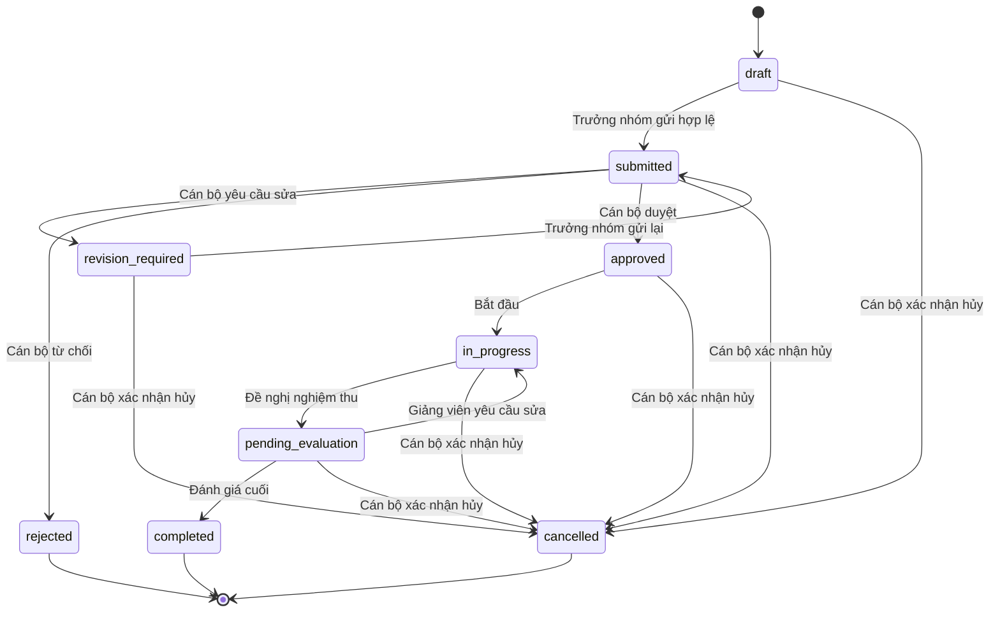
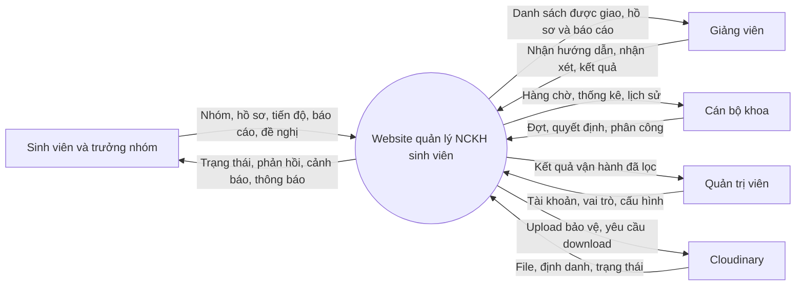
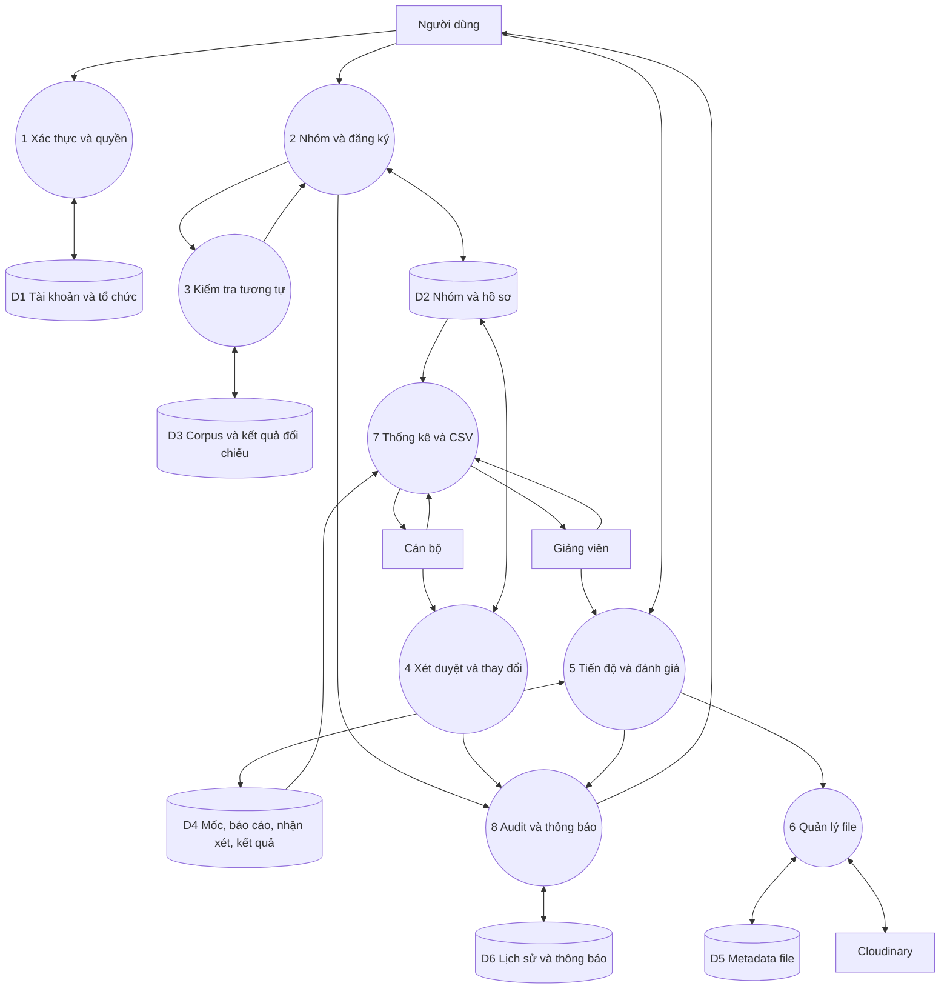

# Tác nhân phân quyền và luồng dữ liệu

Phiên bản kiểm tra 1.0 ngày 21/10/2026. SV: sinh viên; TN: trưởng nhóm; GV: giảng viên hiện hành; CB: cán bộ đúng khoa; QT: quản trị kỹ thuật.

## 1 Ma trận phân quyền

Quyền được cộng theo các vai trò hợp lệ, nhưng vẫn kiểm tra phạm vi và xung đột lợi ích. Trưởng nhóm là SV có thuộc tính leader trong nhóm. Một người không tự duyệt yêu cầu hoặc hồ sơ mà mình đang là thành viên sinh viên; nếu kiêm vai trò phải chuyển cán bộ khác.

| Thao tác | SV | TN | GV | CB | QT |
|---|---|---|---|---|---|
| Kho metadata đề tài được chia sẻ | Có | Có | Có | Có | Có |
| Hồ sơ đầy đủ | Nhóm/quyền lịch sử | Nhóm | Được phân công | Trong scope | Không mặc nhiên |
| Tạo nhóm, nhận/từ chối lời mời | Có | Có | Không | Không | Không |
| Mời/xóa thành viên, đổi trưởng nhóm | Không | Trước duyệt | Không | Xử lý yêu cầu sau duyệt | Không |
| Sửa/gửi hồ sơ nháp/cần sửa | Không | Có | Không | Không sửa thay sinh viên | Không |
| Chấp nhận hướng dẫn | Không | Không | Đề nghị gửi cho mình | Chốt phân công | Không |
| Duyệt/yêu cầu sửa/từ chối | Không | Không | Không | Có | Không |
| Bắt đầu thực hiện | Không | Không | Được phân công | Có | Không |
| Cập nhật tiến độ/nộp báo cáo | Nhóm hiện hành | Có | Không nộp thay | Không nộp thay | Không |
| Nhận xét/đạt/cần sửa bản nộp | Không | Không | Được phân công | Xem/điều phối | Không |
| Đề nghị nghiệm thu | Không | Có | Không | Không thay người đề nghị | Không |
| Đánh giá cuối | Không | Không | Giảng viên chính | Sửa sai sau hoàn thành | Không |
| Đề nghị thay đổi/hủy | Không | Có | Góp ý | Quyết định | Không |
| Tải file | Quyền hồ sơ/phiên bản | Nhóm | Được phân công | Trong scope | Không mặc nhiên |
| Mở đợt, sửa mốc/hạn | Không | Không | Mở lại mốc có lý do | Có, trong scope | Cấu hình kỹ thuật |
| Báo cáo/CSV | Không | Không | Đề tài hướng dẫn | Trong scope | Không mặc nhiên |
| Tạo/import tài khoản SV/GV | Không | Không | Không | Trong khoa, vai trò cơ bản | Có |
| Cấp vai trò CB/QT và scope | Không | Không | Không | Không | Có |
| Xem audit | Phần được phép của đề tài | Như SV | Được phân công | Nghiệp vụ đúng scope | Log vận hành đã lọc |

Thông tin mật khẩu/token không ai được xem từ API. Tài khoản hết quyền phải bị chặn API cả khi còn JWT chưa hết hạn. Quyền download link kiểm tra tại thời điểm cấp; link đã cấp có thể dùng đến hết 5 phút.

## 2 Quyền đọc lịch sử

- Trước duyệt: người rời/bị loại khỏi nhóm mất quyền tài liệu riêng, kể cả file mình từng nộp trong workspace nhóm.
- Sau duyệt: người từng tham gia có khoảng quyền đọc; chỉ xem các phiên bản phát sinh trong khoảng được cấp và snapshot duyệt mà họ thuộc nhóm. Không tự thấy file sau ngày rời.
- Nhóm hoàn thành/đóng không tự mất quyền đọc hồ sơ hợp lệ cũ.
- Giảng viên bị thay không giữ quyền đọc/nghiệp vụ chỉ vì từng hướng dẫn; nhận xét cũ vẫn mang tên tác giả.
- CB có thể thu hồi quyền lịch sử với lý do/audit. Không xóa membership để thu hồi quyền.
- Download và nội dung preview cùng áp dụng một chính sách, không chỉ ẩn nút.

## 3 Trạng thái

| Đối tượng | Enum và ý nghĩa |
|---|---|
| Tài khoản | active, locked |
| Nhóm | active, closed; closed có reason |
| Lời mời | pending, accepted, declined, cancelled, expired |
| Đề nghị hướng dẫn | pending, accepted, declined, cancelled, expired |
| Đề tài | draft, submitted, revision_required, approved, in_progress, pending_evaluation, completed, rejected, cancelled |
| Yêu cầu thay đổi/hủy | pending, approved, rejected, withdrawn, conflicted |
| File | pending, ready, failed |
| Bản báo cáo | pending_review, changes_requested, accepted |
| Kết quả cuối | passed, failed; chưa đánh giá biểu diễn bằng chưa có evaluation |
| Kiểm tra tương tự | pending, succeeded, failed |

Thời hạn lời mời và đề nghị hướng dẫn lấy từ hạn đợt; hết hạn không tự trở thành accepted. Có thể thu hồi lời mời chưa xử lý. Không cho nhiều đề nghị hướng dẫn pending đồng thời cho cùng đề tài trong bản đầu.

## 4 Điều kiện chuyển trạng thái

| Hành động | Người thực hiện | Điều kiện và kết quả |
|---|---|---|
| Gửi/gửi lại | TN | Đúng revision; trong hạn; đủ thành viên đã nhận lời; form hợp lệ; GV đã nhận; kiểm tra tương tự thành công; lưu snapshot bất biến |
| Duyệt | CB | submitted; đúng scope; đúng snapshot; GV hoạt động; xác nhận 3 mốc có hạn/đầu ra; kiểm tra lại nếu corpus đổi |
| Yêu cầu sửa/từ chối | CB | submitted; lý do bắt buộc; từ chối đóng nhóm và giải phóng chỗ |
| Bắt đầu | GV/CB | approved; GV hiện hành; chuyển in_progress |
| Đề nghị nghiệm thu | TN | in_progress; mọi mốc required có bản hiện hành accepted; không có yêu cầu thay đổi/hủy pending |
| Trả lại thực hiện | GV | pending_evaluation; lý do; mở lại mốc rõ ràng nếu phải nộp lại |
| Kết luận cuối | GV | pending_evaluation; passed/failed, nhận xét; score tùy chọn; đóng nhóm |
| Hủy | CB | Chưa kết thúc; quyết định đề nghị hoặc chủ động, có lý do |
| Sửa kết quả | CB | completed; ghi phiên bản mới/lý do, giữ completed |

Khóa hồ sơ học thuật/thành viên khi submitted để nội dung không đổi trong lúc chờ duyệt. Cần sửa mới mở lại phần được phép. Yêu cầu sau duyệt chỉ nhận khi approved/in_progress; pending_evaluation phải trả lại thực hiện trước nếu cần thay đổi. Hủy là ngoại lệ có thể thực hiện khi pending_evaluation.

## 5 DFD ngữ cảnh

## 6 DFD mức một

Mọi process đều áp dụng kiểm tra quyền từ P1; sơ đồ không vẽ lặp đường quyền để dễ đọc. Không có tác nhân truy cập trực tiếp database.

## 7 Các luồng nghiệp vụ cụ thể

### UC01 Tạo nhóm và mời thành viên

SV chọn đợt còn mở, tạo nhóm và trở thành trưởng nhóm. TN mời tài khoản cùng khoa. Người nhận chấp nhận; backend khóa hàng nhóm, kiểm tra min/max, membership hoạt động trong đợt rồi thêm thành viên và audit trong giao dịch. Hai lời mời đồng thời không được làm vượt max. TN chuyển quyền trước khi rời; nhóm không có hồ sơ có thể đóng để giải phóng chỗ.

### UC02 Đăng ký và xét duyệt

TN lưu nháp, đính kèm hồ sơ, đề nghị GV và nhận xác nhận. TN xem trước tương tự rồi gửi. Backend kiểm tra lại trên dữ liệu hiện hành, lưu topic_revision, liên kết file, snapshot thành viên và similarity_check; đổi submitted, ghi audit/thông báo trong giao dịch. CB xem đúng snapshot, yêu cầu sửa/từ chối/duyệt. Khi có cảnh báo, CB xem xét và nếu duyệt phải ghi nhận định. Không bỏ qua corpus đổi giữa kiểm tra và duyệt.

### UC03 Theo dõi và nộp báo cáo

GV/CB bắt đầu; SV hiện hành ghi tiến độ và upload file. Upload ready chưa tính đã nộp. SV chọn mốc và xác nhận submission; backend cấp version nguyên tử, lưu hạn áp dụng/thời gian server và isLate. GV nhận xét bản hiện hành; nếu cần sửa, SV nộp phiên bản mới. Đã accepted chỉ nộp lại khi GV mở lại. Người dùng không tự sửa giờ nộp hoặc nhãn muộn.

### UC04 Nghiệm thu

TN đề nghị khi mọi mốc bắt buộc đạt. Backend kiểm tra cùng revision/transaction để không đua với thao tác mở lại mốc. GV yêu cầu sửa đưa về in_progress hoặc kết luận passed/failed kèm nhận xét đưa completed. Hoàn thành kể cả failed đều kết thúc hồ sơ và giải phóng chỗ; kết quả tách khỏi trạng thái.

### UC05 Thay đổi và hủy

TN gửi before/after và lý do. Thay nội dung/tên chạy lại tương tự; thêm người cần họ xác nhận và kiểm tra chỗ; thay GV cần GV mới nhận. CB áp dụng đúng revision trong giao dịch, lưu snapshot hậu thay đổi, quyền và audit. Yêu cầu xung đột không áp dụng tự động. Đề nghị hủy chưa phải hủy; quyết định CB mới đóng nhóm.

### UC06 Tra cứu và thống kê

Người đăng nhập tra cứu tên, tóm tắt, lĩnh vực, năm, trạng thái, GV của đề tài thuộc kho chia sẻ. Hồ sơ riêng qua workspace kiểm tra quyền. CB thống kê theo khoa chủ trì, GV theo phân công hiện hành; bộ lọc CSV giống màn hình. Đếm đề tài distinct, không nhân theo số thành viên. Thống kê kết quả dùng evaluation hiện hành, không đếm mọi phiên bản.

### UC07 Nhắc hạn và lưu vết

Job chạy hằng ngày kiểm tra mốc chưa đạt, tạo một nhắc cho cửa sổ sắp hạn 3 ngày và một sự kiện quá hạn theo phiên bản hạn; dùng event_key duy nhất. Đổi hạn tạo phiên bản sự kiện mới, không spam mỗi lần mở trang. Hành động nghiệp vụ ghi audit trong cùng transaction; không log bí mật.
