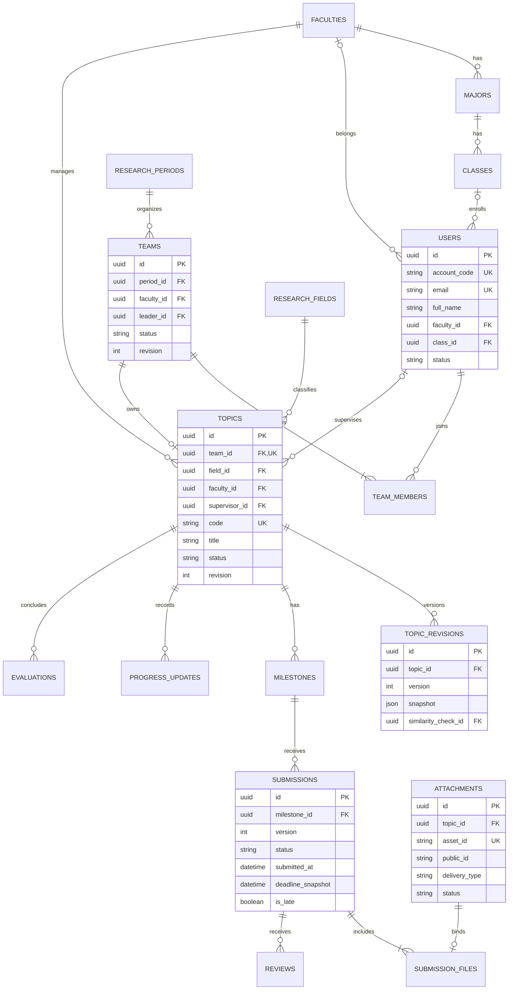
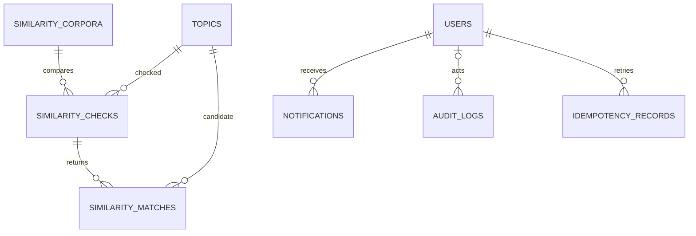

# Thiết kế dữ liệu PostgreSQL

Phiên bản kiểm tra 1.0 ngày 21/10/2026. Đây là mô hình và từ điển dữ liệu để duyệt thiết kế, chưa phải migration hoặc schema Prisma đã chạy.

## 1 Quy ước chung

- Khóa chính UUID; thời gian timestamptz lưu UTC, hiển thị giờ Việt Nam. Tiền tố created_at/updated_at có trên bảng chỉnh sửa được; bảng lịch sử bất biến chỉ cần created_at và tác giả.
- Tên bảng/cột snake_case; API chuyển camelCase. Văn bản Unicode giữ dấu; khóa tìm tên là dữ liệu chuẩn hóa riêng.
- FK mặc định RESTRICT đối với hồ sơ nghiệp vụ. Không cascade xóa lịch sử theo tài khoản. Tài khoản/danh mục ngừng sử dụng thay vì xóa khi đã được tham chiếu.
- Các enum được giới hạn trong schema/API; string trong bản thiết kế không có nghĩa cho phép giá trị bất kỳ.
- JSONB dùng snapshot hoặc cấu hình có giới hạn, không thay các quan hệ cần FK hoặc nhúng mảng lịch sử vô hạn.
- users chứa thông tin tài khoản và hồ sơ cơ bản dùng chung; class_id nullable cho GV/CB, faculty_id bắt buộc khi cần tham gia nghiệp vụ theo khoa. Không có bảng mật khẩu rõ.
- Hệ thống có 34 bảng thiết kế. team_access_grants bổ sung để biểu diễn nhiều khoảng quyền khi thành viên rời và tham gia lại; các bảng còn lại cụ thể hóa danh sách đã chốt. Một backend và một database, không chia thành 34 dịch vụ.

## 2 ERD nghiệp vụ chính

## 3 ERD quyền hồ sơ và quyết định

```mermaid
erDiagram
    USERS ||--o{ USER_ROLES : holds
    USERS ||--o{ MANAGEMENT_SCOPES : manages
    FACULTIES ||--o{ MANAGEMENT_SCOPES : limits
    USERS ||--o{ REFRESH_SESSIONS : authenticates
    TEAMS ||--o{ TEAM_INVITATIONS : invites
    USERS ||--o{ TEAM_INVITATIONS : receives
    TEAM_MEMBERS ||--o{ TEAM_ACCESS_GRANTS : grants
    TOPICS ||--o{ SUPERVISION_REQUESTS : requests
    USERS ||--o{ SUPERVISION_REQUESTS : receives
    TOPICS ||--o{ SUPERVISOR_ASSIGNMENTS : assigns
    USERS ||--o{ SUPERVISOR_ASSIGNMENTS : supervises
    TOPIC_REVISIONS ||--o{ TOPIC_DECISIONS : reviewed
    TOPIC_REVISIONS ||--o{ TOPIC_REVISION_FILES : attaches
    ATTACHMENTS ||--o{ TOPIC_REVISION_FILES : referenced
    TOPICS ||--o{ TOPIC_CHANGE_REQUESTS : changes
    TOPICS ||--o{ TOPIC_CANCELLATION_REQUESTS : cancels
```

## 4 ERD đối chiếu và vận hành

## 5 Từ điển dữ liệu

Ký hiệu: NN là bắt buộc, UQ là duy nhất, FK là tham chiếu. Các trường tác giả đều tham chiếu users; không nhập họ tên tác giả tùy ý từ client. Các cột revision là integer dương, dùng kiểm tra xung đột.

### 5.1 Tài khoản và tổ chức

| Bảng | Trường chính và kiểu | Ràng buộc và cách sử dụng |
|---|---|---|
| faculties | id UUID; code varchar(30); name varchar(200); is_active boolean | code NN/UQ; tên NN |
| majors | id UUID; faculty_id UUID; code varchar(30); name varchar(200); is_active boolean | faculty_id FK; code UQ; không chuyển khoa khi đã có dữ liệu nếu chưa xử lý migration nghiệp vụ |
| classes | id UUID; major_id UUID; code varchar(30); name varchar(200); admission_year int; is_active boolean | major_id FK; code UQ; khoa suy ra từ ngành |
| users | id UUID; account_code varchar(50); email varchar(254); full_name varchar(200); password_hash text; faculty_id UUID?; class_id UUID?; specialization text?; status enum; must_change_password boolean; auth_version int; avatar_asset_id text?; revision int | email/account_code chuẩn hóa UQ; hash NN; tài khoản SV phải có class và khoa nhất quán; avatar chỉ dùng ảnh công khai đã cho phép |
| user_roles | user_id UUID; role enum(student,lecturer,faculty_staff,admin) | PK(user_id,role); nhiều vai trò nhưng kiểm tra xung đột lợi ích |
| management_scopes | user_id UUID; faculty_id UUID | PK(user_id,faculty_id); chỉ có ý nghĩa khi có vai trò faculty_staff |
| refresh_sessions | id UUID; user_id UUID; family_id UUID; token_hash text; absolute_expires_at timestamptz; rotated_at timestamptz?; replaced_by UUID?; revoked_at timestamptz?; revoke_reason text? | token_hash UQ; giữ dấu vết token đã xoay đến hết family để phát hiện reuse; tuyệt đối không lưu raw token |

auth_version hỗ trợ thu hồi khi khóa/đổi mật khẩu/quyền thay đổi; API còn kiểm tra session và quyền hiện hành, không chỉ đọc vai trò cũ trong JWT.

### 5.2 Đợt nhóm và quyền thành viên

| Bảng | Trường chính và kiểu | Ràng buộc và cách sử dụng |
|---|---|---|
| research_periods | id UUID; name varchar(200); academic_year varchar(20); faculty_id UUID; registration_start/end timestamptz; min_members/max_members int; status enum; revision int | Đợt thuộc một khoa; start < end; 1 <= min <= max; academic_year dạng 2026-2027; cấu hình mốc lưu JSONB có giới hạn rồi copy sang milestones khi duyệt |
| research_fields | id UUID; code varchar(30); name varchar(200); is_active boolean | code UQ; danh mục dùng chung |
| teams | id UUID; period_id UUID; faculty_id UUID; leader_id UUID; name varchar(200); status enum(active,closed); closed_reason text?; revision int | Leader là member hiện hành; FK period/faculty nhất quán; nhóm closed không tái dùng |
| team_members | id UUID; team_id UUID; student_id UUID; period_id UUID; active boolean; joined_at timestamptz; left_at timestamptz?; left_reason text?; revision int | UQ(team_id,student_id); UQ có điều kiện(period_id,student_id) khi active; row định danh quan hệ, khi tái tham gia dùng lại row và thêm khoảng quyền mới |
| team_access_grants | id UUID; membership_id UUID; readable_from timestamptz; readable_until timestamptz?; retained_after_leave boolean; revoked_at timestamptz?; granted_by UUID; revoke_reason text? | Một membership có nhiều khoảng quyền; không chồng khoảng; chỉ giữ sau rời nếu đã được duyệt; full revoke có lý do. Timestamps so với thời điểm hồ sơ/file được công bố, không so thời gian client upload |
| team_invitations | id UUID; team_id UUID; invitee_id UUID; invited_by UUID; status enum; expires_at timestamptz; responded_at timestamptz?; response_reason text? | Chỉ một pending/team/invitee; không chiếm chỗ trước accepted; kiểm tra lại chỗ/max/khoa trong transaction khi accepted |

Khi đóng nhóm do kết thúc đề tài, active=false giải phóng chỗ nhưng khoảng quyền đọc hợp lệ còn giữ. Khi rời trước duyệt, thu hồi mọi khoảng quyền riêng của nhóm. Khi tái tham gia, không tự mở quyền cho giai đoạn đã vắng mặt.

### 5.3 Đề tài phiên bản và quyết định

| Bảng | Trường chính và kiểu | Ràng buộc và cách sử dụng |
|---|---|---|
| topics | id UUID; team_id UUID; period_id UUID; faculty_id UUID; field_id UUID; supervisor_id UUID?; proposed_supervisor_id UUID?; code varchar(40); title varchar(250); normalized_title text; abstract/objectives/research_content/methodology/expected_outcomes text; status enum; revision int; current_revision_id UUID?; submitted_at/approved_at/completed_at timestamptz? | team_id UQ; code UQ; khoa chủ trì bất biến; supervisor nullable trước duyệt, NN từ approved; mã do server cấp |
| topic_revisions | id UUID; topic_id UUID; version int; kind enum(submission,approved_change); snapshot JSONB; created_by UUID; similarity_check_id UUID?; source_change_request_id UUID?; published_at timestamptz | UQ(topic_id,version); snapshot bất biến nội dung, roster đã xác nhận, lĩnh vực/đợt/khoa/GV; revision số khác topics.revision chống sửa đè |
| topic_revision_files | topic_revision_id UUID; attachment_id UUID | PK cặp; cùng topic; một file đề xuất có thể được giữ ở nhiều snapshot; không dùng lại file báo cáo như file proposal nếu chưa có quy tắc rõ |
| supervision_requests | id UUID; topic_id UUID; lecturer_id UUID; requested_by UUID; purpose enum(initial,replacement); change_request_id UUID?; status enum; expires_at/responded_at timestamptz?; response_reason text? | Một pending/topic; chỉ người nhận phản hồi; initial phải accepted trước gửi; replacement gắn thay đổi được cán bộ duyệt |
| supervisor_assignments | id UUID; topic_id UUID; lecturer_id UUID; assigned_by UUID; started_at timestamptz; ended_at timestamptz?; reason text? | Một assignment chưa kết thúc/topic; đổi cùng transaction với topics.supervisor_id và quyền |
| topic_decisions | id UUID; topic_revision_id UUID; decided_by UUID; action enum(approve,request_revision,reject); reason text?; similarity_check_id UUID?; warning_justification text?; created_at timestamptz | Bất biến; reason bắt buộc khi sửa/từ chối; nếu approve có cảnh báo phải có justification; cùng transaction chuyển trạng thái |
| topic_change_requests | id UUID; topic_id UUID; requested_by UUID; type enum(academic,members,supervisor); before_data/after_data JSONB; base_revision int; reason text; status enum; similarity_check_id UUID?; decided_by UUID?; decision_reason text?; decided_at timestamptz?; revision int | Kiểm tra theo schema type; không nhận arbitrary patch; mời thêm người phải accepted; một pending/topic trong core; stale -> conflicted |
| topic_cancellation_requests | id UUID; topic_id UUID; requested_by UUID; reason text; status enum; decided_by UUID?; decision_reason text?; decided_at timestamptz?; revision int | Một pending/topic; chỉ cán bộ quyết định; rút yêu cầu trước quyết định; hủy chủ động ghi audit riêng |

Snapshot chứa tối thiểu title, abstract, objectives, researchContent, methodology, expectedOutcomes, team/member IDs và tên/mã tại thời điểm đó, field/period/faculty IDs, GV đề xuất/chính phù hợp giai đoạn. Dữ liệu định danh snapshot chỉ hiển thị trong workspace có quyền.

Thành viên chờ bổ sung sau duyệt dùng team_invitations có change_request_id tùy chọn khi triển khai; accepted ở ngữ cảnh này chỉ ghi nhận đồng ý, chưa kích hoạt membership cho tới CB duyệt. Cần thêm trường invitation.purpose enum(initial,approved_change) và change_request_id FK để phân biệt. Kiểm tra chỗ/max lặp lại lúc CB áp dụng, không hứa giữ chỗ từ lúc họ đồng ý.

### 5.4 Mốc tiến độ báo cáo và file

| Bảng | Trường chính và kiểu | Ràng buộc và cách sử dụng |
|---|---|---|
| milestones | id UUID; topic_id UUID; code varchar(30); name varchar(200); required boolean; expected_output text; deadline timestamptz; sort_order int; resubmission_allowed boolean; revision int | UQ(topic_id,code); hạn copy từ cấu hình khi duyệt; mở lại có audit; không suy accepted từ progress % |
| progress_updates | id UUID; topic_id UUID; milestone_id UUID?; author_id UUID; completed_work/difficulties/next_plan text; self_reported_percent int; created_at timestamptz | CHECK 0..100; milestone nếu có phải cùng topic; tác giả là SV hiện hành; cập nhật thêm bản ghi, không ghi đè nhật ký cũ |
| attachments | id UUID; topic_id UUID; uploaded_by UUID; purpose enum(proposal,report,private_image); original_name text; mime_type varchar(150); size_bytes bigint; asset_id text?; public_id text; resource_type enum(raw,image); delivery_type enum(authenticated); sha256 text?; status enum; verified_at timestamptz?; error_code text? | public_id do server sinh; asset_id UQ khi có; size >0 <= giới hạn; pending chưa được gắn hồ sơ/nộp; raw cho file giữ nguyên bản |
| submissions | id UUID; milestone_id UUID; submitted_by UUID; version int; note text?; status enum; submitted_at timestamptz; deadline_snapshot timestamptz; is_late boolean; revision int | UQ(milestone_id,version); server finalize mới ghi thời gian; status pending_review ban đầu; bản hiện hành là version lớn nhất đã finalize |
| submission_files | submission_id UUID; attachment_id UUID | PK cặp; attachment_id UQ trong bảng; 1–5 file ready/cùng topic; file report không bị ghi đè |
| reviews | id UUID; submission_id UUID; reviewer_id UUID; comment text; decision enum(comment_only,changes_requested,accepted); supersedes_review_id UUID?; created_at timestamptz | Append-only; quyết định trên bản hiện hành; sửa sai tham chiếu review trước, có lý do trong comment; trạng thái submission cập nhật cùng transaction |
| evaluations | id UUID; topic_id UUID; version int; evaluator_id UUID; result enum(passed,failed); score numeric(4,2)?; comment text; correction_reason text?; supersedes_id UUID?; created_at timestamptz | UQ(topic_id,version); score 0..10 nếu có; version 1 do GV hiện hành; bản sửa do CB và có correction_reason; evaluation hiện hành là version mới nhất |

Trạng thái file ready được ghi sau upload/xác minh trên server. File chưa bind được dọn theo TTL có đối chiếu. Không tự xóa Cloudinary asset do xóa một liên kết snapshot nếu asset còn tham chiếu nơi khác.

### 5.5 Tương tự thông báo và vận hành

| Bảng | Trường chính và kiểu | Ràng buộc và cách sử dụng |
|---|---|---|
| similarity_corpora | id UUID; version bigint; algorithm_version text; normalizer_version text; stopwords_version text; config JSONB; corpus_size int; artifact_public_id text?; artifact_sha256 text?; is_active boolean; built_at timestamptz | version UQ; một corpus active; artifact TF-IDF lưu private server-only; config chứa ngưỡng khi đã hiệu chỉnh |
| similarity_checks | id UUID; topic_id UUID; requested_by UUID; purpose enum(preview,submit,approve,change); corpus_id UUID; input_snapshot JSONB; input_hash text; status enum; exact_title_match boolean?; title_threshold/content_threshold numeric?; has_warning boolean?; error_code text?; completed_at timestamptz? | Snapshot immutable khi succeeded; trường điểm/cảnh báo null khi failed; size=0 thật khác lỗi load; check trỏ corpus version |
| similarity_matches | id UUID; check_id UUID; candidate_topic_id UUID; candidate_revision_id UUID; rank int; title_score/content_score numeric; candidate_metadata JSONB | UQ(check_id,rank), UQ(check_id,candidate_topic_id); rank 1..5, score 0..1; metadata không có roster/file/nhận xét |
| notifications | id UUID; recipient_id UUID; type text; title/body text; entity_type text; entity_id UUID?; event_key text; read_at timestamptz?; created_at timestamptz | UQ(recipient_id,event_key); nội dung không nhúng tài liệu riêng; click vẫn kiểm tra quyền hiện hành |
| audit_logs | id UUID; actor_id UUID?; actor_kind enum(user,system); action text; entity_type text; entity_id UUID; faculty_id UUID?; before_data/after_data JSONB?; reason text?; request_id text; created_at timestamptz | Bất biến; filter scope; không secrets/token/signed URL; system job có actor_kind system |
| idempotency_records | id UUID; actor_id UUID; operation text; idempotency_key text; request_hash text; status enum(processing,completed); response_status int?; response_data JSONB?; expires_at timestamptz | UQ(actor_id,operation,key); lưu 24 giờ cho retry; cùng key khác hash ->409; không lưu signed link hoặc token xác thực vào response_data |

Chỉ áp dụng idempotency lưu response cho thao tác nghiệp vụ như submit/nộp/kết quả; không lưu nội dung token/login/download link trong bảng này. Nếu xử lý lỗi trước commit thì không giữ trạng thái processing vô hạn; có timeout/recovery.

## 6 Chỉ mục và ràng buộc ưu tiên

1. users(email), users(account_code) unique sau chuẩn hóa; không đổi email gây trùng kiểu chữ hoa/thường.
2. teams/period và team_members theo student, partial unique membership hoạt động. Composite FK kiểm tra team_members.period_id khớp team.period_id.
3. topics(team_id), topics(code) unique; index theo faculty_id/period_id/status/field_id/supervisor_id và created_at theo truy vấn đo được.
4. pg_trgm trên normalized_title với loại index phù hợp; so tên dùng dữ liệu chuẩn hóa thống nhất, không suy ra ngữ nghĩa.
5. UQ(topic_id,version) cho snapshot/evaluation; UQ(milestone_id,version) cho submissions.
6. supervisor_assignments một row ended_at IS NULL cho mỗi topic; pending request/invitation unique theo khóa nghiệp vụ.
7. milestone/topic FK, file/topic FK; table liên kết phải cùng topic, dùng composite FK hoặc transaction/trigger được kiểm thử.
8. notifications(recipient_id,event_key) unique; index(recipient_id,read_at,created_at). similarity_matches(check_id,rank) unique.
9. PostgreSQL sequence cho mã NCKH-YYYY-NNNN; không hứa số liên tục hoặc reset theo năm. Phiên bản theo topic/milestone cấp bằng khóa hàng + transaction, không count+1 không khóa.
10. updated_at và revision tăng tại mọi thay đổi có kiểm soát; snapshot/audit/review cũ không được sửa từ API thông thường.

## 7 Giao dịch và cạnh tranh

| Thao tác | Các thay đổi phải nhất quán |
|---|---|
| Nhận lời mời | Khóa team, kiểm tra scope/max/chỗ; update invitation, membership, quyền, revision, audit, notification |
| Gửi hồ sơ | Kiểm tra revision đầu vào và corpus; tạo topic_revision/file links, đổi status, audit, thông báo |
| Duyệt | Kiểm tra snapshot/corpus mới nhất, assignment, milestones, corpus revision mới, status, audit/thông báo |
| Nộp báo cáo | Khóa milestone, kiểm tra mở lại/status/ownership, cấp version, bind file, timestamp/deadline, audit/thông báo |
| Nhận xét | Kiểm tra GV/bản hiện hành, append review, update submission, revision/audit/thông báo |
| Nghiệm thu | Khóa topic và kiểm tra mốc hiện hành; ghi evaluation, completed, đóng team, giải phóng active, audit/thông báo |
| Đổi người/nội dung | Kiểm tra request revision, membership mới/chỗ/GV mới, snapshot/quyền/corpus khi cần, audit/thông báo |

File Cloudinary không thuộc transaction PostgreSQL: dùng pending -> ready, tham chiếu sau commit và job dọn nếu thất bại. Không mở transaction DB dài trong lúc client đang upload.

Đối chiếu corpus dùng kiểm soát version: tính kết quả trên corpus V; lúc commit khóa/check version đang active. Nếu khác phải tính lại và retry hữu hạn, hết retry trả xung đột/thử lại. Khi duyệt hồ sơ mới, metadata corpus/candidate availability phải tăng version trong cùng giao dịch; artifact xây dựng trước có thể thành mồ côi nếu rollback và được dọn. Không cho hai hồ sơ cùng duyệt dựa mãi trên corpus cũ mà không kiểm tra lại.

## 8 Khả năng triển khai

Mô hình đủ cho kiểm tra thiết kế. Khi lập trình phải tạo schema Prisma, migration SQL, seed, tập test FK/unique/concurrency và đối chiếu kiểu dữ liệu API. Hình ERD chỉ tóm tắt, từ điển và ràng buộc mới mô tả đầy đủ. Việc schema có nhiều bảng không thay thế nhu cầu kiểm thử quyền và luồng thực tế.
