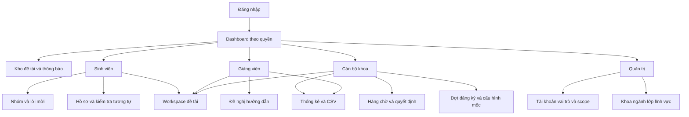

# Giao diện kiểm thử triển khai và bàn giao

Phiên bản kiểm tra 1.0 ngày 21/10/2026. Các màn hình và kịch bản dưới đây là thiết kế/kế hoạch, chưa phải ảnh sản phẩm hoặc kết quả chạy test.

## 1 Cấu trúc màn hình



Một người kiêm nhiều vai trò có các menu phù hợp, quyền hành động vẫn gắn đối tượng. Workspace là trang dùng chung theo quyền, không cần viết một phiên bản riêng cho mỗi vai trò.

## 2 Danh sách màn hình

| Mã | Màn hình | Nội dung và thao tác chính |
|---|---|---|
| UI01 | Đăng nhập | Email/mật khẩu, lỗi rõ ràng, không tiết lộ tài khoản có tồn tại hay không |
| UI02 | Hồ sơ và đổi mật khẩu | Thông tin cơ bản, đổi mật khẩu bắt buộc lần đầu, đăng xuất |
| UI03 | Dashboard | SV: việc cần làm; GV: chờ nhận xét; CB: chờ duyệt/chậm hạn; QT: vận hành được phép |
| UI04 | Kho tra cứu | Search/filter/paging, metadata đề tài; không mở file/thành viên riêng |
| UI05 | Đợt nghiên cứu | Hạn, số thành viên, khoa, hướng dẫn và biểu mẫu |
| UI06 | Nhóm và lời mời | Tạo nhóm, mời/nhận/từ chối, trưởng nhóm, rời/đóng nhóm đúng điều kiện |
| UI07 | Form đề tài | Nháp, validation, gửi hướng dẫn, kiểm tra tương tự, gửi xét duyệt |
| UI08 | Kết quả đối chiếu | Top5, điểm tên/nội dung riêng, giải thích đây là cảnh báo; lỗi có thử lại |
| UI09 | Workspace tổng quan | Trạng thái, thành viên, GV, đợt/lĩnh vực, timeline; nội dung theo quyền |
| UI10 | Hồ sơ xét duyệt | Phiên bản theo từng lần gửi, quyết định và file tương ứng |
| UI11 | Mốc và tiến độ | Deadline, required, bản hiện hành, % tự khai, nhật ký khó khăn/kế hoạch |
| UI12 | Upload và báo cáo | Upload trạng thái rõ, chọn 1–5 file, xác nhận nộp, phiên bản và muộn |
| UI13 | Nhận xét | GV xem đúng bản, comment/đạt/cần sửa, lịch sử giữ nguyên |
| UI14 | Nghiệm thu và kết quả | Đề nghị, điều kiện chưa đạt, GV kết luận, CB sửa sai có lý do |
| UI15 | Yêu cầu thay đổi/hủy | Form theo loại, trước/sau, lời mời/xác nhận liên quan, trạng thái quyết định |
| UI16 | Đề nghị hướng dẫn | Danh sách gửi cho GV, nội dung đủ xem xét, nhận/từ chối |
| UI17 | Hàng chờ cán bộ | Scope/khoa, filter, snapshot, tương tự, approve/revise/reject |
| UI18 | Quản lý đợt và mốc | Hạn/min/max/mốc mẫu, lý do thay hạn, lịch sử |
| UI19 | Thống kê | Bộ lọc, tổng/breakdown/biểu đồ, CSV khớp dữ liệu |
| UI20 | Thông báo | Chưa đọc/đã đọc, click tới đối tượng còn quyền |
| UI21 | Tài khoản và import | Tạo/sửa/khóa, lỗi CSV theo dòng, reset mật khẩu |
| UI22 | Vai trò và phạm vi | QT cấp role/scope; chặn xóa admin cuối cùng |
| UI23 | Danh mục tổ chức | Khoa/ngành/lớp/lĩnh vực, active/inactive, không xóa tham chiếu |
| UI24 | Lịch sử đề tài | Ai/khi nào/hành động/lý do; lọc thông tin nhạy cảm theo quyền |

## 3 Bố cục đề xuất

Workspace:

```text
Mã và tên đề tài                       Trạng thái hiện tại
Khoa | Đợt | Lĩnh vực | Giảng viên

Tổng quan | Hồ sơ | Tiến độ | Báo cáo | Kết quả | Lịch sử

Nội dung tab hiện tại
- Danh sách mốc và hạn
- Bản nộp hiện hành, trạng thái nhận xét
- Thao tác được phép theo vai trò và trạng thái
```

Hàng chờ duyệt:

```text
Khoa được quản lý | Đợt | Lĩnh vực | Trạng thái | Tìm kiếm
Mã | Tên | Nhóm | GV | Ngày gửi | Cảnh báo | Xem hồ sơ

Chi tiết: phiên bản đã gửi + file + kết quả đối chiếu
Quyết định: Duyệt / Yêu cầu sửa / Từ chối
Lý do và xác nhận mốc thực hiện
```

Không nhét khóa kỹ thuật/corpus JSON/database ID vào luồng sử dụng thông thường. Không chỉ dùng màu để thể hiện trạng thái; có nhãn chữ. Form có nhãn, lỗi tại trường và tổng lỗi khi gửi. Có trạng thái đang tải, rỗng, mất kết nối, lỗi quyền và xung đột revision. Hiển thị cảnh báo thay đổi chưa lưu.

## 4 Chính sách thử nghiệm

Vitest cho quy tắc/thuật toán; Supertest với PostgreSQL thử nghiệm cho API/transaction; Playwright cho các luồng chính theo vai trò. Mock dịch vụ chỉ phục vụ một số test, vẫn phải có kiểm tra tích hợp thật Cloudinary và môi trường triển khai. Không dùng database sản xuất để chạy test phá dữ liệu.

| Mã | Kịch bản | Kết quả mong đợi | Yêu cầu |
|---|---|---|---|
| TC01 | Đăng nhập đúng/sai, khóa tài khoản | Phiên hợp lệ; lỗi không lộ bí mật; khóa chặn API | FR01 |
| TC02 | Refresh đồng thời, token cũ reuse | Rotation nguyên tử; frontend điều phối; reuse thu hồi family | FR01 |
| TC03 | Logout/đổi mật khẩu/reset | JWT còn hạn không vượt qua kiểm tra phiên đã thu hồi | FR01/02 |
| TC04 | CB tự cấp admin hoặc mở scope | Bị chặn; có audit phù hợp | FR25 |
| TC05 | Hai nhóm cùng mời một SV, nhận đồng thời | Tối đa một membership active/đợt | FR03 |
| TC06 | Nhận hai lời mời vào nhóm chỉ còn một chỗ | Không vượt max; request còn lại lỗi nghiệp vụ | FR03 |
| TC07 | TN rời khi chưa chuyển quyền | Bị chặn; không có nhóm thiếu trưởng nhóm | FR03 |
| TC08 | Nhóm chưa có topic đóng | Giải phóng chỗ, giữ lịch sử | FR03 |
| TC09 | Hồ sơ thiếu form, thiếu người, hết hạn, GV chưa nhận | Không submitted; lỗi chỉ rõ điều kiện | FR05/16 |
| TC10 | Hồ sơ hợp lệ gửi/retry | Một snapshot/transition, không tạo bản kép | FR05/17 |
| TC11 | Đọc/sửa nháp nhóm khác bằng ID trực tiếp | Không truy cập được | FR08/25 |
| TC12 | CB khoa khác quyết định hoặc tải file | Bị chặn API và download link | FR07/24 |
| TC13 | Duyệt đúng snapshot và corpus đã đổi | Chạy lại/kiểm tra version, lưu quyết định đúng đầu vào | FR06/07 |
| TC14 | File sai đuôi/MIME/cấu trúc/giới hạn | Bị từ chối, không ready | FR11 |
| TC15 | Upload lỗi giữa Cloudinary và DB | Không tính đã nộp, retry/dọn được mồ côi | FR11/26 |
| TC16 | Finalize chưa có file ready hoặc file topic khác | Bị chặn; không bind file sai quyền | FR11 |
| TC17 | Nộp lại và retry đồng thời | Phiên bản không trùng; cùng idempotency trả cùng bản | FR11 |
| TC18 | Finalize trước/sau/đúng deadline, sau đó đổi hạn | Nhãn muộn dùng > theo server; snapshot hạn cũ không bị viết lại | FR11 |
| TC19 | GV nhận xét bản cũ hoặc không được phân công | Không đổi trạng thái bản hiện hành | FR12 |
| TC20 | Mốc đã đạt nộp lại khi chưa mở lại | Bị chặn; mở lại có lý do mới cho nộp | FR22 |
| TC21 | Nghiệm thu đồng thời mở lại mốc | Không completed dựa điều kiện đã mất hiệu lực | FR12/22 |
| TC22 | Đạt/không đạt và điểm không nhất quán ngưỡng tự đặt | Kết quả theo lựa chọn có thẩm quyền, không tự suy điểm | FR12 |
| TC23 | Sửa sai kết quả | Chỉ CB, có lý do/phiên bản mới; giữ lịch sử | FR23 |
| TC24 | Đổi thành viên/GV/nội dung sau duyệt | Qua request, kiểm tra consent/chỗ/revision/tương tự, cập nhật quyền | FR18/19 |
| TC25 | Người rời trước/sau duyệt, rồi tham gia lại | Đúng khoảng quyền; không tự đọc khoảng vắng mặt | FR21 |
| TC26 | Giảng viên cũ/admin kỹ thuật tải file riêng | Bị chặn cấp link | FR24/25 |
| TC27 | Link download hết 5 phút | Link ngắn hạn hết hiệu lực theo cơ chế đã kiểm chứng | FR24 |
| TC28 | Đề nghị hủy pending và CB quyết định | Pending chưa đóng nhóm; approve mới đóng | FR20 |
| TC29 | CSV cùng bộ lọc và JOIN nhiều thành viên | Tổng đúng distinct topic; evaluation hiện hành | FR14 |
| TC30 | CSV chứa tên bắt đầu =,+,-,@ | Không tạo công thức nguy hiểm khi mở bảng tính | FR14 |
| TC31 | Job nhắc hạn/dọn file chạy lại | Không spam, không xóa asset còn tham chiếu | FR13/26 |
| TC32 | Corpus rỗng và corpus tải lỗi | Rỗng thành công có size0; lỗi không giả điểm0 | FR06 |
| TC33 | Bộ kiểm thử tương tự có nhãn | Báo precision/recall/FP/FN; không chỉnh ngưỡng bằng test | FR06 |
| TC34 | 1.000 đề tài, truy vấn thường và tương tự | Báo p95 theo cấu hình, hai loại phép đo riêng | NFR05 |
| TC35 | Khôi phục database + file backup | Mở hồ sơ, lịch sử, tải file/checksum đúng | FR26 |
| TC36 | Môi trường Vercel/Render thật | Proxy, cookie, CORS/CSRF, upload20MB, tải file và scheduler đúng | NFR09/12 |

Đây là danh sách phải chạy, không phải bảng kết quả PASS. Báo cáo test sau triển khai phải có ngày, phiên bản commit, môi trường, kết quả và bằng chứng/lỗi còn lại.

## 5 Dữ liệu demo và đánh giá tương tự

Tối thiểu: 3 nhóm, 2 GV, 1 CB, 1 QT; đủ SV cho nhóm; hai khoa để kiểm tra scope chéo; lớp/ngành/lĩnh vực; đợt đang mở/đã đóng; hồ sơ nháp/chờ duyệt/cần sửa/đang thực hiện/chờ nghiệm thu/hoàn thành/từ chối/hủy; file muộn, nhiều phiên bản, request thay đổi/hủy và lịch sử quyền.

Dùng dữ liệu hư cấu có nhãn demo. Tài khoản test không dùng mật khẩu mặc định dễ đoán trên môi trường public; chia sẻ thông tin demo qua kênh phù hợp, không đưa secret vào repo.

Thuật toán:

1. Chuẩn bị ít nhất 60 cặp có nhãn: 20 trùng, 20 gần giống, 20 khác. Trùng/gần là positive theo mục tiêu cảnh báo.
2. Chia theo đề tài nguồn để biến thể không rơi cả hiệu chỉnh và test; mục tiêu 40/20 cặp, ưu tiên giữ cân bằng khi thực hiện được.
3. Chuẩn hóa NFC, giữ dấu; tên giống hệt luôn cảnh báo. TF-IDF fit trên corpus tham chiếu, cấu hình unigram/bigram/stopwords có version.
4. Xếp top5 theo max(titleScore,contentScore), tie-break xác định bằng code/ID; giữ hai điểm riêng.
5. Hiệu chỉnh ngưỡng ưu tiên recall >=0,90 trên tập hiệu chỉnh rồi precision cao; nếu không đạt, công bố kết quả thực tế và hạn chế.
6. Khóa ngưỡng trước chạy test. Báo precision, recall, confusion matrix, ví dụ cảnh báo nhầm/bỏ sót, thời gian chạy và số đề tài corpus.
7. Dataset hiệu năng 1.000 đề tài tách khỏi bộ nhãn. Dữ liệu sinh tự động không chứng minh độ chính xác học thuật.

## 6 Cấu trúc mã nguồn dự kiến

```text
app/
  client/
    src/
      app/              router, providers
      features/         auth, teams, topics, progress, reports, admin
      components/       thành phần dùng chung
      services/         API client
      utils/
  server/
    src/
      modules/          auth, users, catalogs, teams, topics,
                        submissions, reviews, similarity, reports
      middleware/       xác thực, quyền, validation, lỗi
      jobs/             nhắc hạn, dọn file
      services/         Cloudinary, corpus
      db/               Prisma client và transaction helpers
      config/
    prisma/
      schema.prisma
      migrations/
      seed.js
  tests/
    e2e/
  docs/
    openapi.yaml
```

Đây là sơ đồ tổ chức đề xuất, không khẳng định các file đã tồn tại. Không đưa secret vào client/VITE_* hoặc commit .env thật. Validation schema chia sẻ chỉ phần an toàn, không kéo module server vào bundle client.

## 7 Triển khai và cấu hình

| Môi trường | Mục đích |
|---|---|
| Development | React/Express local, PostgreSQL test/dev, Cloudinary test theo cấu hình |
| Test | Database riêng, seed/reset có kiểm soát, test role/concurrency |
| Demo | Vercel frontend, Render backend, Supabase PostgreSQL, Cloudinary; không dữ liệu thật |

Biến môi trường backend dự kiến: DATABASE_URL, MIGRATION_DATABASE_URL nếu cần riêng, JWT_SECRET, JWT_ISSUER, JWT_AUDIENCE, APP_ORIGIN, COOKIE settings, CLOUDINARY_CLOUD_NAME/API_KEY/API_SECRET, FILE_MAX_BYTES, IMAGE_MAX_BYTES, SCHEDULER_SECRET khi dùng endpoint job được bảo vệ. Frontend chỉ có URL API/cấu hình công khai.

API cùng origin thông qua /api proxy; kiểm tra Set-Cookie/Secure/SameSite/Origin và header proxy thật. Nếu proxy không đáp ứng upload/download, phải điều chỉnh kiến trúc có tài liệu và test cookie/CORS, không bỏ kiểm tra quyền để chạy được.

Checklist trước publish:
- Khóa phiên bản, migration từ database rỗng, seed idempotent, backup trước thay schema có dữ liệu.
- Xác minh tài khoản Cloudinary raw/authenticated và link tải 5 phút, bật PDF nếu bị chặn, file20MB thật. Không hứa free tier đáp ứng.
- Xác minh Supabase cho extension/index/migration cần dùng và cấu hình kết nối PostgreSQL/connection pool phù hợp; không giả định Prisma mặc định đã tối ưu mọi môi trường.
- Render có health check, giới hạn request/upload hợp lý, log lọc secret; upload tạm dọn khi lỗi; không lưu kho file trên đĩa tạm.
- Scheduler thực tế chạy job nhắc hạn/dọn mỗi ngày; job có retry/khóa chống chạy trùng, không phụ thuộc browser hoặc timer instance ngủ.
- Rate limit login, search sinh viên, upload, similarity; validation giới hạn payload và timeout; thông báo lỗi có requestId.
- Kiểm tra quota/chính sách/gói của từng dịch vụ tại thời điểm deploy; việc chọn nền tảng không phải phê duyệt chi phí.

## 8 Sao lưu và khôi phục

Baseline vận hành demo: backup PostgreSQL hằng ngày; manifest file theo attachment/asset/checksum; sao lưu nội dung file riêng vào kho được bảo vệ; giữ 7 bản gần nhất như cấu hình ban đầu có thể điều chỉnh theo dung lượng được cấp. Không coi link Cloudinary hoặc metadata backup là bản sao file.

Thử khôi phục sang môi trường riêng trước nghiệm thu: import DB, kiểm tra FK/versions/roles, đối chiếu manifest, khôi phục hoặc ánh xạ asset, tải file và kiểm tra checksum. Secret phục hồi được cấp lại, không ghi trong bản backup chia sẻ. Mục tiêu mất dữ liệu tối đa một ngày là mục tiêu vận hành theo lịch backup, chưa phải SLA đã chứng minh.

## 9 Lộ trình và phân công

| Giai đoạn | Công việc | Điều kiện hoàn tất |
|---|---|---|
| 1 | Chốt hồ sơ, wireframe, schema/API | Không còn xung đột phạm vi; có phê duyệt yêu cầu |
| 2 | Khung code, DB/migration, auth/roles/scopes | Login, quyền, seed và test nền hoạt động |
| 3 | Nhóm/hồ sơ/hướng dẫn/xét duyệt | Luồng gửi và quyết định có snapshot, audit |
| 4 | Tiến độ/file/nhận xét/kết quả/thay đổi | Phiên bản, deadline, quyền lịch sử đúng |
| 5 | Tương tự/báo cáo/thông báo | Thuật toán có đánh giá, CSV khớp, job hoạt động |
| 6 | Tích hợp, test, deploy, bàn giao | Checklist test có kết quả, restore đạt, hướng dẫn thật |

Nhóm 3 người: người1 frontend; người2 backend/database/auth/nghiệp vụ; người3 tương tự/file/test/deploy. Tích hợp và viết báo cáo cùng làm. Chưa đặt thời hạn hoàn thành vì chưa có lịch học/giờ làm và ngày bàn giao do người dùng cung cấp.

## 10 Bàn giao

1. Website demo có URL và tài khoản từng vai trò; chức năng theo phạm vi và test có bằng chứng.
2. Mã nguồn JavaScript, lockfile, Prisma schema/migration SQL, seed và .env.example.
3. OpenAPI thực thi và hướng dẫn chạy/test/deploy/backup.
4. Báo cáo đồ án gồm khảo sát nguồn, yêu cầu, tác nhân/use case, DFD, ERD, thiết kế API/UI, thuật toán và kết quả kiểm thử, hạn chế.
5. Hướng dẫn người dùng theo vai trò với ảnh chụp từ sản phẩm thực tế.
6. Bộ dữ liệu demo và bộ đánh giá tương tự có nguồn/nhãn/quy tắc chia tập; không bí mật hoặc dữ liệu cá nhân thật.

Bộ hồ sơ hiện tại mới chuẩn bị các nội dung thiết kế/kế hoạch. Chưa tạo ảnh chụp UI, test report thực, migration, OpenAPI executable hoặc website demo.
