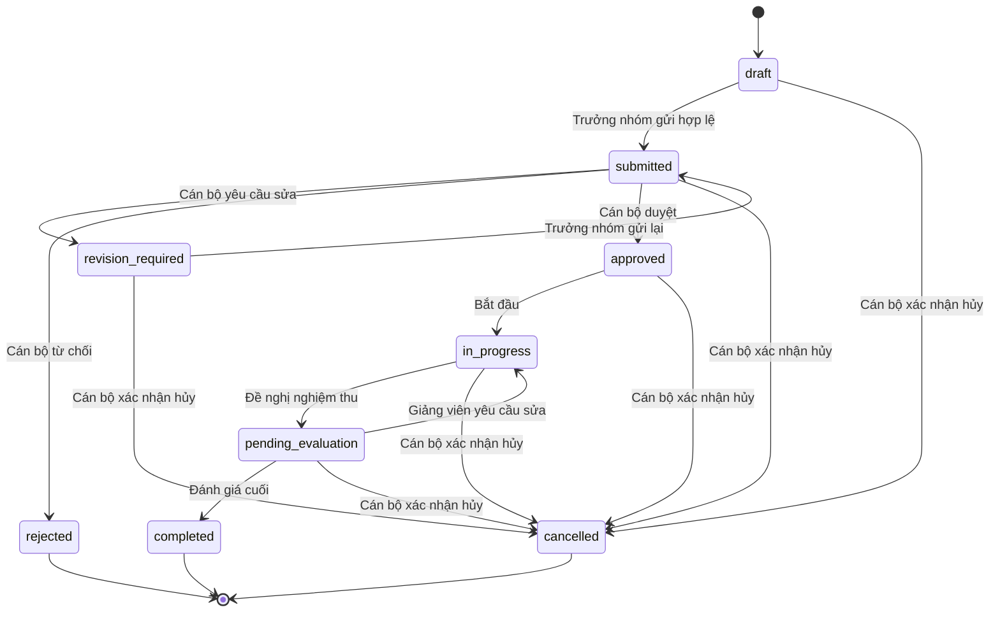
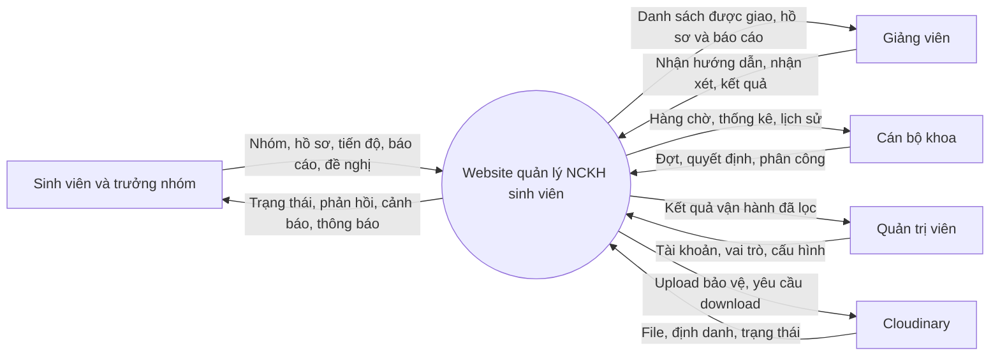
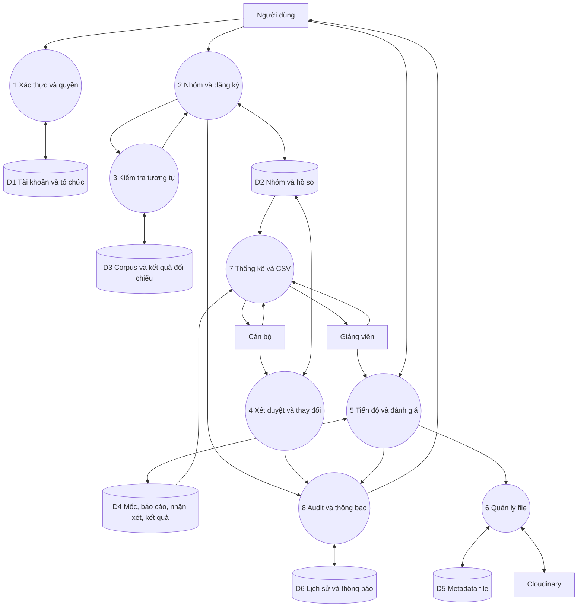
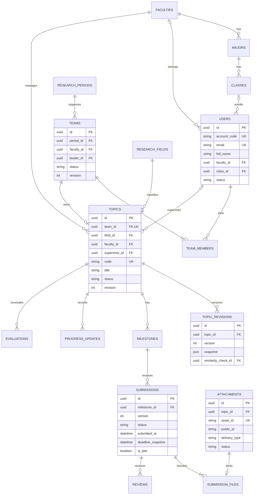
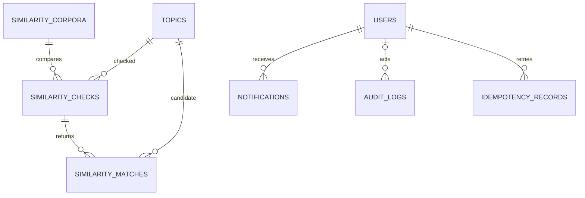
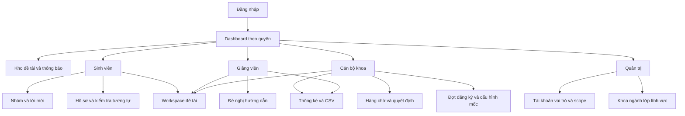

# Hồ sơ tổng hợp dự án để kiểm tra và chốt

Website hỗ trợ quản lý hoạt động nghiên cứu khoa học sinh viên

Cập nhật ngày 21/10/2026. Phiên bản kiểm tra 1.0.

Đây là bản đọc liên tục gồm toàn bộ bảy tài liệu thiết kế và phiếu chốt. Các bản riêng trong cùng thư mục thuận tiện tra cứu từng phần. Bản yêu cầu lịch sử được lưu riêng trong PROJECT_REQUIREMENTS_SNAPSHOT.md để tránh nhầm lựa chọn cũ với thiết kế hiện hành.

# Bộ hồ sơ kiểm tra và chốt dự án

Website hỗ trợ quản lý hoạt động nghiên cứu khoa học sinh viên

Phiên bản hồ sơ: 1.0 để kiểm tra. Ngày cập nhật: 21/10/2026, múi giờ Việt Nam.

## Mục đích

Bộ hồ sơ tập hợp các lựa chọn hiện hành và diễn giải thành yêu cầu, quyền, luồng xử lý, dữ liệu, API, màn hình, kiểm thử và triển khai để chủ dự án kiểm tra trước khi chốt triển khai. Bộ hồ sơ chưa phải sản phẩm phần mềm đã nghiệm thu.

Có thể đọc toàn bộ nội dung trong [bản tổng hợp liên tục](HO_SO_TONG_HOP.md) hoặc đọc từng tài liệu bên dưới.

## Tài liệu trong bộ hồ sơ

| Thứ tự | Tài liệu | Nội dung kiểm tra |
|---|---|---|
| 1 | [Tổng quan và yêu cầu](01_TONG_QUAN_VA_YEU_CAU.md) | Mục tiêu, phạm vi, công nghệ, chức năng và tiêu chí chất lượng |
| 2 | [Tác nhân quyền và luồng](02_TAC_NHAN_QUYEN_VA_LUONG.md) | Phân quyền, trạng thái, DFD và tình huống nghiệp vụ |
| 3 | [Thiết kế dữ liệu](03_THIET_KE_DU_LIEU.md) | ERD, bảng dữ liệu, trường chính, khóa và giao dịch |
| 4 | [Đặc tả API](04_DAC_TA_API.md) | Quy ước, endpoint, payload, lỗi và quyền truy cập |
| 5 | [Giao diện kiểm thử và triển khai](05_GIAO_DIEN_KIEM_THU_TRIEN_KHAI.md) | Màn hình, test, dữ liệu mẫu, vận hành và bàn giao |
| 6 | [Phiếu kiểm tra và chốt](06_PHIEU_KIEM_TRA_VA_CHOT.md) | Danh sách nội dung cần rà soát, xác nhận hoặc điều chỉnh |
| 7 | PROJECT_REQUIREMENTS_SNAPSHOT.md | Bản sao nguyên trạng yêu cầu gốc và lịch sử lựa chọn tại ngày đóng gói |

## Cách hiểu trạng thái

- Đã chọn: lựa chọn thiết kế đã được người dùng giao lựa chọn và ghi tại mục 13 của PROJECT_REQUIREMENTS.md.
- Chi tiết hóa để kiểm tra: tên trường, enum, endpoint và cách tổ chức màn hình được cụ thể hóa trong bộ hồ sơ này; chưa có code/migration/OpenAPI thực thi để chứng minh hoạt động.
- Cần kiểm chứng: hạn mức tài khoản dịch vụ, hiệu năng, độ chính xác thuật toán, upload/download và sao lưu; chỉ xác nhận sau chạy thử thực tế.
- Chưa thực hiện: xây dựng website, tạo dịch vụ, mua gói, publish, chạy kiểm thử và tạo ảnh chụp hướng dẫn sử dụng.

## Lựa chọn hiện hành

JavaScript, React/Vite/React Router, Tailwind CSS, React Hook Form/Zod, TanStack Query; Express/Node.js; PostgreSQL/Prisma; Cloudinary cho ảnh và tài liệu. Frontend trên Vercel, backend trên Render, PostgreSQL trên Supabase. Không dùng TypeScript, MongoDB/Mongoose, Vercel Blob hoặc Supabase Storage trong phương án này.

Tác nhân: sinh viên, giảng viên, cán bộ khoa, quản trị viên. Trưởng nhóm là thuộc tính thành viên. Hội đồng độc lập và kinh phí nằm ngoài bản đầu.

## Các điểm thay đổi so với bản cũ

| Nội dung cũ | Nội dung hiện hành |
|---|---|
| MongoDB và Mongoose | PostgreSQL và Prisma |
| Đề xuất TypeScript | JavaScript toàn bộ ứng dụng |
| Blob hoặc Supabase Storage cho tài liệu | Cloudinary raw/authenticated |
| Express có thể trên Vercel | Express trên Render, frontend trên Vercel |
| Upload trực tiếp theo chữ ký là luồng chính | Upload qua Express để xác minh file trong bản đầu |
| Tên gần giống dùng Dice JavaScript | pg_trgm; ngưỡng phải hiệu chỉnh lại |
| Một cờ quyền đọc lịch sử | Kiểm soát quyền theo thời gian và phiên bản tài liệu |

## Điểm phải biết trước khi xác nhận

1. Giới hạn 20 MB/file là yêu cầu ứng dụng, chưa xác minh tài khoản Cloudinary hiện có hỗ trợ. Không tự mua gói hoặc hạ giới hạn để coi là đã đạt.
2. Cảnh báo tương tự hỗ trợ xét duyệt; không phải phát hiện mọi trường hợp trùng ý hoặc đạo văn. Ngưỡng số chưa chốt vì phải đo bằng dữ liệu có nhãn.
3. Nhóm 1–3 người, cùng khoa, giảng viên đánh giá cuối là baseline đồ án, không tuyên bố đây là quy chế của trường.
4. Thiết kế này có khoảng ba chục bảng nhỏ theo nghiệp vụ; không đồng nghĩa phải có từng ấy màn hình hoặc dịch vụ riêng.
5. Việc chốt hồ sơ cho phép lập trình theo phạm vi; không đồng nghĩa phê duyệt chi phí hoặc xác nhận website đã hoàn thành.

## Nguồn và thứ tự áp dụng

Nguồn chính là yêu cầu người dùng trong hội thoại, tài liệu Word tham khảo và PROJECT_REQUIREMENTS.md mục 13 cùng các điều khoản cũ chưa bị thay thế. Tài liệu nguồn trong sources/ không được sửa. Bộ hồ sơ này hợp nhất cách trình bày để đọc; nếu phát hiện khác biệt ngoài các lựa chọn đã thống nhất, ghi vào phiếu chốt để sửa trước khi lập trình.

Không kèm tài liệu Word gốc trong gói tải nhằm tránh nhân bản tài liệu tham khảo không cần thiết. Bộ hồ sơ có danh sách nguồn trong tài liệu 01.


# Tổng quan và yêu cầu dự án

Phiên bản kiểm tra 1.0 ngày 21/10/2026.

## 1 Mục tiêu và bài toán

Website hỗ trợ quản lý hoạt động nghiên cứu khoa học sinh viên trong một trường. Hệ thống tập trung hồ sơ, nhóm thực hiện và giảng viên; theo dõi các mốc, tài liệu, nhận xét và kết quả; hỗ trợ kiểm tra tương tự khi đăng ký và tổng hợp số liệu.

Các vấn đề cần xử lý là dữ liệu phân tán qua email/bảng tính, khó theo dõi thời hạn, khó biết bản báo cáo hiện hành, thiếu lịch sử phê duyệt, tổng hợp thủ công và khó tra cứu đề tài có khả năng trùng lặp. Đây là mô tả bài toán cần khảo sát, không phải số liệu khảo sát đã thu thập tại trường.

## 2 Phạm vi

| Trong bản đầu | Ngoài bản đầu |
|---|---|
| Tài khoản do cán bộ/quản trị được cấp quyền tạo hoặc nhập CSV | Đăng ký tài khoản tự do, SSO |
| Danh mục khoa/ngành/lớp/lĩnh vực; đợt đăng ký | Quản lý nhân sự và đào tạo toàn trường |
| Nhóm cùng khoa, lời mời, một trưởng nhóm | Nhóm liên khoa/liên trường |
| Hồ sơ, xác nhận hướng dẫn, xét duyệt, yêu cầu sửa | Hội đồng độc lập, phản biện tự động, tự xếp lịch |
| Tiến độ, file theo giai đoạn, nhận xét và kết quả | Hợp đồng, kinh phí, quy đổi giờ |
| Trùng tên/tương tự nội dung nhập trong form | Đọc toàn bộ PDF/Word, tìm đạo văn Internet |
| Tra cứu metadata, thông báo trong web, CSV | Email/SMS/chat, chatbot và API AI |
| Lịch sử, yêu cầu thay đổi/hủy, phân quyền | Ứng dụng di động riêng |

Không tuyên bố giảm 80–90% công sức khi chưa đo. Hiệu quả được đánh giá bằng thời gian xử lý, mức đầy đủ dữ liệu và kết quả kiểm thử.

## 3 Công nghệ đã chọn

| Thành phần | Lựa chọn | Mục đích |
|---|---|---|
| Ngôn ngữ | JavaScript ES modules, JSX, SQL cho migration | Đồng nhất mã ứng dụng, không dùng TypeScript |
| Frontend | React, Vite, React Router | Giao diện theo vai trò |
| UI | Tailwind CSS | Responsive, tiếng Việt |
| Form | React Hook Form, Zod | Kiểm tra form; backend kiểm tra độc lập |
| Dữ liệu UI | TanStack Query | Cache, tải lại, phân trang; xóa cache khi logout |
| Backend | Node.js LTS, Express, REST | Một ứng dụng chia module |
| Database | PostgreSQL trên Supabase | Dữ liệu quan hệ, FK, transaction, thống kê |
| ORM | Prisma bằng JavaScript, Prisma Migrate | Truy vấn và thay đổi schema có phiên bản |
| Đăng nhập | JWT, refresh token, Argon2id | Phiên có thu hồi và mật khẩu băm |
| File | Cloudinary | raw/authenticated cho tài liệu, image/upload cho ảnh công khai |
| Tương tự | pg_trgm, TF-IDF và cosine bằng JavaScript | So tên/nội dung; không thêm Python service |
| Báo cáo | Recharts, CSV | Biểu đồ và danh sách xuất |
| Kiểm thử | Vitest, Supertest, Playwright | Unit, integration, end-to-end |
| API docs | OpenAPI và Swagger UI phù hợp môi trường | Hợp đồng API |
| Deploy | Vercel frontend, Render backend | Database/file lưu dịch vụ bền vững |

Không dùng Supabase Auth hoặc Storage trong phương án hiện hành; Supabase cung cấp PostgreSQL. Không cần Redux, Redis, microservices hoặc Kubernetes trong bản đầu. Phiên bản chính xác khóa khi khởi tạo sau kiểm tra tương thích.

## 4 Yêu cầu chức năng

FR01–FR15 giữ ý nghĩa yêu cầu core đã lưu; FR16–FR26 cụ thể hóa các bổ sung. Mọi tiêu chí dưới đây là điều kiện nghiệm thu cần thực hiện, chưa phải kết quả đã kiểm thử.

| Mã | Chức năng | Điều kiện đạt chính |
|---|---|---|
| FR01 | Đăng nhập, logout, đổi mật khẩu, refresh | Tài khoản khóa không dùng được phiên; logout thu hồi phiên hiện tại |
| FR02 | Quản lý tài khoản, nhập CSV, reset mật khẩu | Mã/email không trùng; báo lỗi theo dòng; không cho tự nâng quyền |
| FR03 | Nhóm, thành viên và trưởng nhóm | Lời mời được chấp nhận mới thành thành viên; không vượt giới hạn hoặc tham gia chồng |
| FR04 | Khoa/ngành/lớp/lĩnh vực/đợt | Danh mục được kiểm tra tham chiếu; min/max và các hạn hợp lệ |
| FR05 | Hồ sơ đề tài | Lưu nháp, sửa khi hợp lệ, gửi đúng quyền; sinh mã chống trùng |
| FR06 | Kiểm tra tương tự | Top 5, điểm riêng, snapshot và version; lỗi không được coi là không tương tự |
| FR07 | Xét duyệt | Đúng cán bộ/khoa/revision; lưu lý do và người xử lý |
| FR08 | Tra cứu và danh sách | Bộ lọc, phân trang; kho chung không lộ file/thành viên/nhận xét |
| FR09 | Mốc thực hiện | Có đầu ra, hạn, required; thay hạn có lịch sử |
| FR10 | Cập nhật tiến độ | Lưu tác giả, việc đã làm/khó khăn/kế hoạch; % là tự khai |
| FR11 | Upload và nộp báo cáo | File ready; bản mới không ghi đè; nhãn muộn theo server |
| FR12 | Nhận xét và đánh giá | Chỉ giảng viên hiện hành, đúng bản nộp; kết quả cuối và nhận xét bắt buộc |
| FR13 | Thông báo trong web | Có trạng thái đã đọc, nhắc hạn và chống trùng sự kiện |
| FR14 | Thống kê và CSV | Giảng viên/lĩnh vực/trạng thái/kết quả/khoa/năm/đợt; số liệu CSV khớp |
| FR15 | Lịch sử xử lý | Ghi ai, khi nào, thao tác, đối tượng và thay đổi cần thiết |
| FR16 | Đề nghị nhận hướng dẫn | Giảng viên nhận/từ chối; đã nhận mới cho gửi xét duyệt |
| FR17 | Phiên bản hồ sơ xét duyệt | Mỗi lần gửi có snapshot bất biến; quyết định trỏ đúng snapshot |
| FR18 | Thay đổi sau duyệt | Yêu cầu trước/sau, lý do, kiểm tra xung đột; cán bộ quyết định |
| FR19 | Thay giảng viên | Giảng viên mới nhận, cán bộ duyệt; quyền giảng viên cũ chấm dứt |
| FR20 | Đề nghị và quyết định hủy | Đang chờ không tự đóng; quyết định có lý do |
| FR21 | Rời nhóm và đọc lịch sử | Người rời trước duyệt mất quyền; sau duyệt theo khoảng quyền và phiên bản |
| FR22 | Mở lại mốc đã đạt | Giảng viên có lý do; điều kiện nghiệm thu dùng bản hiện hành |
| FR23 | Sửa sai kết quả | Cán bộ tạo phiên bản mới có lý do; không xóa đánh giá trước |
| FR24 | Tải tài liệu riêng | Kiểm tra quyền rồi cấp link 5 phút; không công khai URL cố định |
| FR25 | Vai trò và phạm vi | Admin không tự có quyền nghiệp vụ; cán bộ chỉ thao tác khoa được cấp |
| FR26 | Sao lưu và dọn file | Khôi phục được cả dữ liệu/file; dọn mồ côi không xóa tài liệu đã nộp |

## 5 Quy tắc dữ liệu đầu vào

| Trường | Quy tắc cho demo |
|---|---|
| Tên đề tài | 10–250 ký tự sau trim |
| Tóm tắt | 100–5.000 ký tự sau trim |
| Mục tiêu | 50–5.000 ký tự sau trim |
| Nội dung nghiên cứu | 200–20.000 ký tự sau trim |
| Phương pháp và sản phẩm dự kiến | Bắt buộc khi gửi; tối đa 10.000 ký tự mỗi trường |
| Nhóm | 1–3 người mặc định; min/max theo đợt; cùng khoa |
| Báo cáo | 1–5 file/lần; PDF/DOCX/XLSX/PPTX, tối đa 20 MB/file |
| Ảnh | JPEG/PNG/WebP, tối đa 5 MB; phân biệt ảnh riêng/công khai |
| Tiến độ | Số nguyên 0–100, không thay thế xác nhận giảng viên |
| Điểm | Tùy chọn 0–10; không tự suy ra đạt/không đạt |
| Ngày giờ | Lưu UTC; hiển thị Asia/Ho_Chi_Minh |

Các mức tối đa văn bản là chi tiết hóa form để kiểm tra trong bản hồ sơ này, không phải quy chế trường. Độ dài tối thiểu không bảo đảm chất lượng học thuật. MB trong kiểm tra file của ứng dụng được thống nhất là 1.000.000 byte và phải dùng cùng một giá trị ở UI/API/test.

## 6 Yêu cầu chất lượng

| Mã | Yêu cầu | Cách chứng minh |
|---|---|---|
| NFR01 | Phân quyền theo đối tượng và scope | Test chéo vai trò, ID và tải file |
| NFR02 | Xác thực an toàn | Kiểm tra Argon2id, rotation, reuse, thu hồi, Origin/CSRF |
| NFR03 | Toàn vẹn dữ liệu | FK/unique/check/transaction; test thao tác đồng thời |
| NFR04 | File đúng loại và giới hạn | Đọc chữ ký/định dạng thực, không tin MIME client; kiểm tra cấu trúc OOXML |
| NFR05 | Hiệu năng tra cứu | Mục tiêu p95 <2 giây với 1.000 đề tài; ghi máy/tải/bộ lọc; đo thuật toán riêng |
| NFR06 | Dễ sử dụng | Tiếng Việt, bàn phím, nhãn form, responsive, loading/empty/error rõ |
| NFR07 | Lịch sử và phiên bản | Không mất bản nộp/nhận xét khi sửa; có xung đột revision |
| NFR08 | Khôi phục | Khôi phục database, bản sao file và kiểm tra tải lại |
| NFR09 | Triển khai lặp lại được | .env.example không chứa bí mật, migration, seed, lockfile, README |
| NFR10 | Giới hạn thuật toán minh bạch | Bộ nhãn riêng, precision/recall, false positives/negatives |
| NFR11 | Không lộ bí mật | Không đưa API_SECRET vào frontend/log, không log token/download link |
| NFR12 | Tác vụ nền có thể chạy lại | Nhắc hạn/dọn file có khóa chống trùng, retry, log và scheduler thật |

## 7 Tổng hợp tài liệu tham khảo

| Nguồn | Giá trị kế thừa | Cách sử dụng có giới hạn |
|---|---|---|
| Google nguồn 1 Hinet | Dữ liệu tập trung, biểu mẫu và báo cáo, minh bạch | Dựa bản trích trong Word; chưa đối chiếu được trang trong phiên kiểm tra trước |
| Google nguồn 2 Hoàng Hà | Quy trình đề xuất/xét duyệt/nghiệm thu | Không có URL riêng và trùng phần nguồn 4; không đếm là bằng chứng độc lập |
| Google nguồn 3 Thiên An UniResearch | Vòng đời đề tài, sản phẩm và báo cáo | Đã đối chiếu trang trong phiên trước; chọn phần phù hợp sinh viên |
| Google nguồn 4 Hoàng Hà | Hồ sơ, phân quyền, biểu mẫu | Dựa bản trích; không áp dụng nguyên mẫu số hội đồng/thang điểm/công nghệ cũ |
| Soft Việt bổ sung | Đăng ký website, chuyên đề SV, sao lưu | Tách riêng ngoài 4 nguồn đánh số |
| GPT trong Word | Vai trò, luồng trạng thái, phiên bản/lịch sử | Ý tưởng thiết kế, không phải quy chế hoặc bằng chứng hiệu quả |
| Gemini trong Word | Nhóm SV, hướng dẫn, tiến độ, nhắc hạn | Không dùng tuyên bố giảm 80–90% công sức chưa có minh chứng |

So sánh này áp dụng cho các đoạn trả lời trong Word, không xếp hạng năng lực chung của GPT/Gemini. Google là công cụ tìm; nguồn thực tế là các trang doanh nghiệp.

Đường dẫn nguồn:
- Hinet: https://hinet.com.vn/phan-mem-quan-ly-de-tai-nghien-cuu-khoa-hoc-cho-truong-hoc
- Thiên An: https://thienan.vn/thienan_product_uniresearch.html
- Hoàng Hà: http://hhsc.com.vn/chi-tiet-san-pham/9/phan-mem-quan-ly-nghien-cuu-khoa-hoc
- Soft Việt: https://softviet.info/san-pham/san-pham-nha-nuoc/phan-mem-quan-ly-nghien-cuu-khoa-hoc
- Word do người dùng cung cấp: Tài liệu tham khảo_website hỗ trợ quản lý sv nckh.docx.
- Quyết định dự án: PROJECT_REQUIREMENTS.md mục 13, ngày 21/10/2026.

## 8 Sản phẩm bàn giao dự kiến

Website demo và tài khoản theo vai trò; mã nguồn JavaScript kèm migration/seed; đặc tả API OpenAPI thực thi được sau khi xây dựng; báo cáo thiết kế/thuật toán/kiểm thử/hạn chế; hướng dẫn cài đặt/sử dụng có ảnh chụp từ sản phẩm thật. Bộ hồ sơ hiện tại là tài liệu chuẩn bị, chưa phải các bàn giao phần mềm này.

## 9 Tài liệu kỹ thuật chính thức dùng đối chiếu

- [PostgreSQL constraints](https://www.postgresql.org/docs/current/ddl-constraints.html): khóa và ràng buộc dữ liệu.
- [PostgreSQL pg_trgm](https://www.postgresql.org/docs/current/pgtrgm.html): so sánh chuỗi theo trigram.
- [Prisma PostgreSQL](https://www.prisma.io/docs/orm/overview/databases/postgresql): kết nối và mô hình truy cập dữ liệu.
- [Cloudinary upload parameters](https://cloudinary.com/documentation/upload_parameters): raw asset và delivery type.
- [Cloudinary access control](https://cloudinary.com/documentation/control_access_to_media): authenticated và private_download_url; signed link thông thường không tự hết hạn.
- [Cloudinary delivery](https://cloudinary.com/documentation/image_delivery_options): cấu hình phân phối PDF trên tài khoản phù hợp.
- [Render web services](https://render.com/docs/web-services): triển khai Express.
- [Vercel Functions limitations](https://vercel.com/docs/functions/limitations): cần đối chiếu giới hạn đường đi upload/proxy thực tế.
- [Vite](https://vite.dev/guide/), [TanStack Query](https://tanstack.com/query/latest/docs/framework/react/overview), [Playwright](https://playwright.dev/docs/intro): các công cụ hỗ trợ giao diện và kiểm thử.

Các liên kết là tài liệu kỹ thuật để triển khai và kiểm chứng, không phải chứng nhận tài khoản/gói dịch vụ đang đáp ứng yêu cầu. Phiên bản thư viện, hạn mức và chi phí kiểm tra lại khi khởi tạo/deploy.


# Tác nhân phân quyền và luồng dữ liệu

Phiên bản kiểm tra 1.0 ngày 21/10/2026. SV: sinh viên; TN: trưởng nhóm; GV: giảng viên hiện hành; CB: cán bộ đúng khoa; QT: quản trị kỹ thuật.

## 1 Ma trận phân quyền

Quyền được cộng theo các vai trò hợp lệ, nhưng vẫn kiểm tra phạm vi và xung đột lợi ích. Trưởng nhóm là SV có thuộc tính leader trong nhóm. Một người không tự duyệt yêu cầu hoặc hồ sơ mà mình đang là thành viên sinh viên; nếu kiêm vai trò phải chuyển cán bộ khác.

| Thao tác | SV | TN | GV | CB | QT |
|---|---|---|---|---|---|
| Kho metadata đề tài được chia sẻ | Có | Có | Có | Có | Có |
| Hồ sơ đầy đủ | Nhóm/quyền lịch sử | Nhóm | Được phân công | Trong scope | Không mặc nhiên |
| Tạo nhóm, nhận/từ chối lời mời | Có | Có | Không | Không | Không |
| Mời/xóa thành viên, đổi trưởng nhóm | Không | Trước duyệt | Không | Xử lý yêu cầu sau duyệt | Không |
| Sửa/gửi hồ sơ nháp/cần sửa | Không | Có | Không | Không sửa thay sinh viên | Không |
| Chấp nhận hướng dẫn | Không | Không | Đề nghị gửi cho mình | Chốt phân công | Không |
| Duyệt/yêu cầu sửa/từ chối | Không | Không | Không | Có | Không |
| Bắt đầu thực hiện | Không | Không | Được phân công | Có | Không |
| Cập nhật tiến độ/nộp báo cáo | Nhóm hiện hành | Có | Không nộp thay | Không nộp thay | Không |
| Nhận xét/đạt/cần sửa bản nộp | Không | Không | Được phân công | Xem/điều phối | Không |
| Đề nghị nghiệm thu | Không | Có | Không | Không thay người đề nghị | Không |
| Đánh giá cuối | Không | Không | Giảng viên chính | Sửa sai sau hoàn thành | Không |
| Đề nghị thay đổi/hủy | Không | Có | Góp ý | Quyết định | Không |
| Tải file | Quyền hồ sơ/phiên bản | Nhóm | Được phân công | Trong scope | Không mặc nhiên |
| Mở đợt, sửa mốc/hạn | Không | Không | Mở lại mốc có lý do | Có, trong scope | Cấu hình kỹ thuật |
| Báo cáo/CSV | Không | Không | Đề tài hướng dẫn | Trong scope | Không mặc nhiên |
| Tạo/import tài khoản SV/GV | Không | Không | Không | Trong khoa, vai trò cơ bản | Có |
| Cấp vai trò CB/QT và scope | Không | Không | Không | Không | Có |
| Xem audit | Phần được phép của đề tài | Như SV | Được phân công | Nghiệp vụ đúng scope | Log vận hành đã lọc |

Thông tin mật khẩu/token không ai được xem từ API. Tài khoản hết quyền phải bị chặn API cả khi còn JWT chưa hết hạn. Quyền download link kiểm tra tại thời điểm cấp; link đã cấp có thể dùng đến hết 5 phút.

## 2 Quyền đọc lịch sử

- Trước duyệt: người rời/bị loại khỏi nhóm mất quyền tài liệu riêng, kể cả file mình từng nộp trong workspace nhóm.
- Sau duyệt: người từng tham gia có khoảng quyền đọc; chỉ xem các phiên bản phát sinh trong khoảng được cấp và snapshot duyệt mà họ thuộc nhóm. Không tự thấy file sau ngày rời.
- Nhóm hoàn thành/đóng không tự mất quyền đọc hồ sơ hợp lệ cũ.
- Giảng viên bị thay không giữ quyền đọc/nghiệp vụ chỉ vì từng hướng dẫn; nhận xét cũ vẫn mang tên tác giả.
- CB có thể thu hồi quyền lịch sử với lý do/audit. Không xóa membership để thu hồi quyền.
- Download và nội dung preview cùng áp dụng một chính sách, không chỉ ẩn nút.

## 3 Trạng thái

| Đối tượng | Enum và ý nghĩa |
|---|---|
| Tài khoản | active, locked |
| Nhóm | active, closed; closed có reason |
| Lời mời | pending, accepted, declined, cancelled, expired |
| Đề nghị hướng dẫn | pending, accepted, declined, cancelled, expired |
| Đề tài | draft, submitted, revision_required, approved, in_progress, pending_evaluation, completed, rejected, cancelled |
| Yêu cầu thay đổi/hủy | pending, approved, rejected, withdrawn, conflicted |
| File | pending, ready, failed |
| Bản báo cáo | pending_review, changes_requested, accepted |
| Kết quả cuối | passed, failed; chưa đánh giá biểu diễn bằng chưa có evaluation |
| Kiểm tra tương tự | pending, succeeded, failed |

Thời hạn lời mời và đề nghị hướng dẫn lấy từ hạn đợt; hết hạn không tự trở thành accepted. Có thể thu hồi lời mời chưa xử lý. Không cho nhiều đề nghị hướng dẫn pending đồng thời cho cùng đề tài trong bản đầu.



## 4 Điều kiện chuyển trạng thái

| Hành động | Người thực hiện | Điều kiện và kết quả |
|---|---|---|
| Gửi/gửi lại | TN | Đúng revision; trong hạn; đủ thành viên đã nhận lời; form hợp lệ; GV đã nhận; kiểm tra tương tự thành công; lưu snapshot bất biến |
| Duyệt | CB | submitted; đúng scope; đúng snapshot; GV hoạt động; xác nhận 3 mốc có hạn/đầu ra; kiểm tra lại nếu corpus đổi |
| Yêu cầu sửa/từ chối | CB | submitted; lý do bắt buộc; từ chối đóng nhóm và giải phóng chỗ |
| Bắt đầu | GV/CB | approved; GV hiện hành; chuyển in_progress |
| Đề nghị nghiệm thu | TN | in_progress; mọi mốc required có bản hiện hành accepted; không có yêu cầu thay đổi/hủy pending |
| Trả lại thực hiện | GV | pending_evaluation; lý do; mở lại mốc rõ ràng nếu phải nộp lại |
| Kết luận cuối | GV | pending_evaluation; passed/failed, nhận xét; score tùy chọn; đóng nhóm |
| Hủy | CB | Chưa kết thúc; quyết định đề nghị hoặc chủ động, có lý do |
| Sửa kết quả | CB | completed; ghi phiên bản mới/lý do, giữ completed |

Khóa hồ sơ học thuật/thành viên khi submitted để nội dung không đổi trong lúc chờ duyệt. Cần sửa mới mở lại phần được phép. Yêu cầu sau duyệt chỉ nhận khi approved/in_progress; pending_evaluation phải trả lại thực hiện trước nếu cần thay đổi. Hủy là ngoại lệ có thể thực hiện khi pending_evaluation.

## 5 DFD ngữ cảnh



## 6 DFD mức một



Mọi process đều áp dụng kiểm tra quyền từ P1; sơ đồ không vẽ lặp đường quyền để dễ đọc. Không có tác nhân truy cập trực tiếp database.

## 7 Các luồng nghiệp vụ cụ thể

### UC01 Tạo nhóm và mời thành viên

SV chọn đợt còn mở, tạo nhóm và trở thành trưởng nhóm. TN mời tài khoản cùng khoa. Người nhận chấp nhận; backend khóa hàng nhóm, kiểm tra min/max, membership hoạt động trong đợt rồi thêm thành viên và audit trong giao dịch. Hai lời mời đồng thời không được làm vượt max. TN chuyển quyền trước khi rời; nhóm không có hồ sơ có thể đóng để giải phóng chỗ.

### UC02 Đăng ký và xét duyệt

TN lưu nháp, đính kèm hồ sơ, đề nghị GV và nhận xác nhận. TN xem trước tương tự rồi gửi. Backend kiểm tra lại trên dữ liệu hiện hành, lưu topic_revision, liên kết file, snapshot thành viên và similarity_check; đổi submitted, ghi audit/thông báo trong giao dịch. CB xem đúng snapshot, yêu cầu sửa/từ chối/duyệt. Khi có cảnh báo, CB xem xét và nếu duyệt phải ghi nhận định. Không bỏ qua corpus đổi giữa kiểm tra và duyệt.

### UC03 Theo dõi và nộp báo cáo

GV/CB bắt đầu; SV hiện hành ghi tiến độ và upload file. Upload ready chưa tính đã nộp. SV chọn mốc và xác nhận submission; backend cấp version nguyên tử, lưu hạn áp dụng/thời gian server và isLate. GV nhận xét bản hiện hành; nếu cần sửa, SV nộp phiên bản mới. Đã accepted chỉ nộp lại khi GV mở lại. Người dùng không tự sửa giờ nộp hoặc nhãn muộn.

### UC04 Nghiệm thu

TN đề nghị khi mọi mốc bắt buộc đạt. Backend kiểm tra cùng revision/transaction để không đua với thao tác mở lại mốc. GV yêu cầu sửa đưa về in_progress hoặc kết luận passed/failed kèm nhận xét đưa completed. Hoàn thành kể cả failed đều kết thúc hồ sơ và giải phóng chỗ; kết quả tách khỏi trạng thái.

### UC05 Thay đổi và hủy

TN gửi before/after và lý do. Thay nội dung/tên chạy lại tương tự; thêm người cần họ xác nhận và kiểm tra chỗ; thay GV cần GV mới nhận. CB áp dụng đúng revision trong giao dịch, lưu snapshot hậu thay đổi, quyền và audit. Yêu cầu xung đột không áp dụng tự động. Đề nghị hủy chưa phải hủy; quyết định CB mới đóng nhóm.

### UC06 Tra cứu và thống kê

Người đăng nhập tra cứu tên, tóm tắt, lĩnh vực, năm, trạng thái, GV của đề tài thuộc kho chia sẻ. Hồ sơ riêng qua workspace kiểm tra quyền. CB thống kê theo khoa chủ trì, GV theo phân công hiện hành; bộ lọc CSV giống màn hình. Đếm đề tài distinct, không nhân theo số thành viên. Thống kê kết quả dùng evaluation hiện hành, không đếm mọi phiên bản.

### UC07 Nhắc hạn và lưu vết

Job chạy hằng ngày kiểm tra mốc chưa đạt, tạo một nhắc cho cửa sổ sắp hạn 3 ngày và một sự kiện quá hạn theo phiên bản hạn; dùng event_key duy nhất. Đổi hạn tạo phiên bản sự kiện mới, không spam mỗi lần mở trang. Hành động nghiệp vụ ghi audit trong cùng transaction; không log bí mật.


# Thiết kế dữ liệu PostgreSQL

Phiên bản kiểm tra 1.0 ngày 21/10/2026. Đây là mô hình và từ điển dữ liệu để duyệt thiết kế, chưa phải migration hoặc schema Prisma đã chạy.

## 1 Quy ước chung

- Khóa chính UUID; thời gian timestamptz lưu UTC, hiển thị giờ Việt Nam. Tiền tố created_at/updated_at có trên bảng chỉnh sửa được; bảng lịch sử bất biến chỉ cần created_at và tác giả.
- Tên bảng/cột snake_case; API chuyển camelCase. Văn bản Unicode giữ dấu; khóa tìm tên là dữ liệu chuẩn hóa riêng.
- FK mặc định RESTRICT đối với hồ sơ nghiệp vụ. Không cascade xóa lịch sử theo tài khoản. Tài khoản/danh mục ngừng sử dụng thay vì xóa khi đã được tham chiếu.
- Các enum được giới hạn trong schema/API; string trong bản thiết kế không có nghĩa cho phép giá trị bất kỳ.
- JSONB dùng snapshot hoặc cấu hình có giới hạn, không thay các quan hệ cần FK hoặc nhúng mảng lịch sử vô hạn.
- users chứa thông tin tài khoản và hồ sơ cơ bản dùng chung; class_id nullable cho GV/CB, faculty_id bắt buộc khi cần tham gia nghiệp vụ theo khoa. Không có bảng mật khẩu rõ.
- Hệ thống có 34 bảng thiết kế. team_access_grants bổ sung để biểu diễn nhiều khoảng quyền khi thành viên rời và tham gia lại; các bảng còn lại cụ thể hóa danh sách đã chốt. Một backend và một database, không chia thành 34 dịch vụ.

## 2 ERD nghiệp vụ chính



## 3 ERD quyền hồ sơ và quyết định

```mermaid
erDiagram
    USERS ||--o{ USER_ROLES : holds
    USERS ||--o{ MANAGEMENT_SCOPES : manages
    FACULTIES ||--o{ MANAGEMENT_SCOPES : limits
    USERS ||--o{ REFRESH_SESSIONS : authenticates
    TEAMS ||--o{ TEAM_INVITATIONS : invites
    USERS ||--o{ TEAM_INVITATIONS : receives
    TEAM_MEMBERS ||--o{ TEAM_ACCESS_GRANTS : grants
    TOPICS ||--o{ SUPERVISION_REQUESTS : requests
    USERS ||--o{ SUPERVISION_REQUESTS : receives
    TOPICS ||--o{ SUPERVISOR_ASSIGNMENTS : assigns
    USERS ||--o{ SUPERVISOR_ASSIGNMENTS : supervises
    TOPIC_REVISIONS ||--o{ TOPIC_DECISIONS : reviewed
    TOPIC_REVISIONS ||--o{ TOPIC_REVISION_FILES : attaches
    ATTACHMENTS ||--o{ TOPIC_REVISION_FILES : referenced
    TOPICS ||--o{ TOPIC_CHANGE_REQUESTS : changes
    TOPICS ||--o{ TOPIC_CANCELLATION_REQUESTS : cancels
```



## 4 ERD đối chiếu và vận hành



## 5 Từ điển dữ liệu

Ký hiệu: NN là bắt buộc, UQ là duy nhất, FK là tham chiếu. Các trường tác giả đều tham chiếu users; không nhập họ tên tác giả tùy ý từ client. Các cột revision là integer dương, dùng kiểm tra xung đột.

### 5.1 Tài khoản và tổ chức

| Bảng | Trường chính và kiểu | Ràng buộc và cách sử dụng |
|---|---|---|
| faculties | id UUID; code varchar(30); name varchar(200); is_active boolean | code NN/UQ; tên NN |
| majors | id UUID; faculty_id UUID; code varchar(30); name varchar(200); is_active boolean | faculty_id FK; code UQ; không chuyển khoa khi đã có dữ liệu nếu chưa xử lý migration nghiệp vụ |
| classes | id UUID; major_id UUID; code varchar(30); name varchar(200); admission_year int; is_active boolean | major_id FK; code UQ; khoa suy ra từ ngành |
| users | id UUID; account_code varchar(50); email varchar(254); full_name varchar(200); password_hash text; faculty_id UUID?; class_id UUID?; specialization text?; status enum; must_change_password boolean; auth_version int; avatar_asset_id text?; revision int | email/account_code chuẩn hóa UQ; hash NN; tài khoản SV phải có class và khoa nhất quán; avatar chỉ dùng ảnh công khai đã cho phép |
| user_roles | user_id UUID; role enum(student,lecturer,faculty_staff,admin) | PK(user_id,role); nhiều vai trò nhưng kiểm tra xung đột lợi ích |
| management_scopes | user_id UUID; faculty_id UUID | PK(user_id,faculty_id); chỉ có ý nghĩa khi có vai trò faculty_staff |
| refresh_sessions | id UUID; user_id UUID; family_id UUID; token_hash text; absolute_expires_at timestamptz; rotated_at timestamptz?; replaced_by UUID?; revoked_at timestamptz?; revoke_reason text? | token_hash UQ; giữ dấu vết token đã xoay đến hết family để phát hiện reuse; tuyệt đối không lưu raw token |

auth_version hỗ trợ thu hồi khi khóa/đổi mật khẩu/quyền thay đổi; API còn kiểm tra session và quyền hiện hành, không chỉ đọc vai trò cũ trong JWT.

### 5.2 Đợt nhóm và quyền thành viên

| Bảng | Trường chính và kiểu | Ràng buộc và cách sử dụng |
|---|---|---|
| research_periods | id UUID; name varchar(200); academic_year varchar(20); faculty_id UUID; registration_start/end timestamptz; min_members/max_members int; status enum; revision int | Đợt thuộc một khoa; start < end; 1 <= min <= max; academic_year dạng 2026-2027; cấu hình mốc lưu JSONB có giới hạn rồi copy sang milestones khi duyệt |
| research_fields | id UUID; code varchar(30); name varchar(200); is_active boolean | code UQ; danh mục dùng chung |
| teams | id UUID; period_id UUID; faculty_id UUID; leader_id UUID; name varchar(200); status enum(active,closed); closed_reason text?; revision int | Leader là member hiện hành; FK period/faculty nhất quán; nhóm closed không tái dùng |
| team_members | id UUID; team_id UUID; student_id UUID; period_id UUID; active boolean; joined_at timestamptz; left_at timestamptz?; left_reason text?; revision int | UQ(team_id,student_id); UQ có điều kiện(period_id,student_id) khi active; row định danh quan hệ, khi tái tham gia dùng lại row và thêm khoảng quyền mới |
| team_access_grants | id UUID; membership_id UUID; readable_from timestamptz; readable_until timestamptz?; retained_after_leave boolean; revoked_at timestamptz?; granted_by UUID; revoke_reason text? | Một membership có nhiều khoảng quyền; không chồng khoảng; chỉ giữ sau rời nếu đã được duyệt; full revoke có lý do. Timestamps so với thời điểm hồ sơ/file được công bố, không so thời gian client upload |
| team_invitations | id UUID; team_id UUID; invitee_id UUID; invited_by UUID; status enum; expires_at timestamptz; responded_at timestamptz?; response_reason text? | Chỉ một pending/team/invitee; không chiếm chỗ trước accepted; kiểm tra lại chỗ/max/khoa trong transaction khi accepted |

Khi đóng nhóm do kết thúc đề tài, active=false giải phóng chỗ nhưng khoảng quyền đọc hợp lệ còn giữ. Khi rời trước duyệt, thu hồi mọi khoảng quyền riêng của nhóm. Khi tái tham gia, không tự mở quyền cho giai đoạn đã vắng mặt.

### 5.3 Đề tài phiên bản và quyết định

| Bảng | Trường chính và kiểu | Ràng buộc và cách sử dụng |
|---|---|---|
| topics | id UUID; team_id UUID; period_id UUID; faculty_id UUID; field_id UUID; supervisor_id UUID?; proposed_supervisor_id UUID?; code varchar(40); title varchar(250); normalized_title text; abstract/objectives/research_content/methodology/expected_outcomes text; status enum; revision int; current_revision_id UUID?; submitted_at/approved_at/completed_at timestamptz? | team_id UQ; code UQ; khoa chủ trì bất biến; supervisor nullable trước duyệt, NN từ approved; mã do server cấp |
| topic_revisions | id UUID; topic_id UUID; version int; kind enum(submission,approved_change); snapshot JSONB; created_by UUID; similarity_check_id UUID?; source_change_request_id UUID?; published_at timestamptz | UQ(topic_id,version); snapshot bất biến nội dung, roster đã xác nhận, lĩnh vực/đợt/khoa/GV; revision số khác topics.revision chống sửa đè |
| topic_revision_files | topic_revision_id UUID; attachment_id UUID | PK cặp; cùng topic; một file đề xuất có thể được giữ ở nhiều snapshot; không dùng lại file báo cáo như file proposal nếu chưa có quy tắc rõ |
| supervision_requests | id UUID; topic_id UUID; lecturer_id UUID; requested_by UUID; purpose enum(initial,replacement); change_request_id UUID?; status enum; expires_at/responded_at timestamptz?; response_reason text? | Một pending/topic; chỉ người nhận phản hồi; initial phải accepted trước gửi; replacement gắn thay đổi được cán bộ duyệt |
| supervisor_assignments | id UUID; topic_id UUID; lecturer_id UUID; assigned_by UUID; started_at timestamptz; ended_at timestamptz?; reason text? | Một assignment chưa kết thúc/topic; đổi cùng transaction với topics.supervisor_id và quyền |
| topic_decisions | id UUID; topic_revision_id UUID; decided_by UUID; action enum(approve,request_revision,reject); reason text?; similarity_check_id UUID?; warning_justification text?; created_at timestamptz | Bất biến; reason bắt buộc khi sửa/từ chối; nếu approve có cảnh báo phải có justification; cùng transaction chuyển trạng thái |
| topic_change_requests | id UUID; topic_id UUID; requested_by UUID; type enum(academic,members,supervisor); before_data/after_data JSONB; base_revision int; reason text; status enum; similarity_check_id UUID?; decided_by UUID?; decision_reason text?; decided_at timestamptz?; revision int | Kiểm tra theo schema type; không nhận arbitrary patch; mời thêm người phải accepted; một pending/topic trong core; stale -> conflicted |
| topic_cancellation_requests | id UUID; topic_id UUID; requested_by UUID; reason text; status enum; decided_by UUID?; decision_reason text?; decided_at timestamptz?; revision int | Một pending/topic; chỉ cán bộ quyết định; rút yêu cầu trước quyết định; hủy chủ động ghi audit riêng |

Snapshot chứa tối thiểu title, abstract, objectives, researchContent, methodology, expectedOutcomes, team/member IDs và tên/mã tại thời điểm đó, field/period/faculty IDs, GV đề xuất/chính phù hợp giai đoạn. Dữ liệu định danh snapshot chỉ hiển thị trong workspace có quyền.

Thành viên chờ bổ sung sau duyệt dùng team_invitations có change_request_id tùy chọn khi triển khai; accepted ở ngữ cảnh này chỉ ghi nhận đồng ý, chưa kích hoạt membership cho tới CB duyệt. Cần thêm trường invitation.purpose enum(initial,approved_change) và change_request_id FK để phân biệt. Kiểm tra chỗ/max lặp lại lúc CB áp dụng, không hứa giữ chỗ từ lúc họ đồng ý.

### 5.4 Mốc tiến độ báo cáo và file

| Bảng | Trường chính và kiểu | Ràng buộc và cách sử dụng |
|---|---|---|
| milestones | id UUID; topic_id UUID; code varchar(30); name varchar(200); required boolean; expected_output text; deadline timestamptz; sort_order int; resubmission_allowed boolean; revision int | UQ(topic_id,code); hạn copy từ cấu hình khi duyệt; mở lại có audit; không suy accepted từ progress % |
| progress_updates | id UUID; topic_id UUID; milestone_id UUID?; author_id UUID; completed_work/difficulties/next_plan text; self_reported_percent int; created_at timestamptz | CHECK 0..100; milestone nếu có phải cùng topic; tác giả là SV hiện hành; cập nhật thêm bản ghi, không ghi đè nhật ký cũ |
| attachments | id UUID; topic_id UUID; uploaded_by UUID; purpose enum(proposal,report,private_image); original_name text; mime_type varchar(150); size_bytes bigint; asset_id text?; public_id text; resource_type enum(raw,image); delivery_type enum(authenticated); sha256 text?; status enum; verified_at timestamptz?; error_code text? | public_id do server sinh; asset_id UQ khi có; size >0 <= giới hạn; pending chưa được gắn hồ sơ/nộp; raw cho file giữ nguyên bản |
| submissions | id UUID; milestone_id UUID; submitted_by UUID; version int; note text?; status enum; submitted_at timestamptz; deadline_snapshot timestamptz; is_late boolean; revision int | UQ(milestone_id,version); server finalize mới ghi thời gian; status pending_review ban đầu; bản hiện hành là version lớn nhất đã finalize |
| submission_files | submission_id UUID; attachment_id UUID | PK cặp; attachment_id UQ trong bảng; 1–5 file ready/cùng topic; file report không bị ghi đè |
| reviews | id UUID; submission_id UUID; reviewer_id UUID; comment text; decision enum(comment_only,changes_requested,accepted); supersedes_review_id UUID?; created_at timestamptz | Append-only; quyết định trên bản hiện hành; sửa sai tham chiếu review trước, có lý do trong comment; trạng thái submission cập nhật cùng transaction |
| evaluations | id UUID; topic_id UUID; version int; evaluator_id UUID; result enum(passed,failed); score numeric(4,2)?; comment text; correction_reason text?; supersedes_id UUID?; created_at timestamptz | UQ(topic_id,version); score 0..10 nếu có; version 1 do GV hiện hành; bản sửa do CB và có correction_reason; evaluation hiện hành là version mới nhất |

Trạng thái file ready được ghi sau upload/xác minh trên server. File chưa bind được dọn theo TTL có đối chiếu. Không tự xóa Cloudinary asset do xóa một liên kết snapshot nếu asset còn tham chiếu nơi khác.

### 5.5 Tương tự thông báo và vận hành

| Bảng | Trường chính và kiểu | Ràng buộc và cách sử dụng |
|---|---|---|
| similarity_corpora | id UUID; version bigint; algorithm_version text; normalizer_version text; stopwords_version text; config JSONB; corpus_size int; artifact_public_id text?; artifact_sha256 text?; is_active boolean; built_at timestamptz | version UQ; một corpus active; artifact TF-IDF lưu private server-only; config chứa ngưỡng khi đã hiệu chỉnh |
| similarity_checks | id UUID; topic_id UUID; requested_by UUID; purpose enum(preview,submit,approve,change); corpus_id UUID; input_snapshot JSONB; input_hash text; status enum; exact_title_match boolean?; title_threshold/content_threshold numeric?; has_warning boolean?; error_code text?; completed_at timestamptz? | Snapshot immutable khi succeeded; trường điểm/cảnh báo null khi failed; size=0 thật khác lỗi load; check trỏ corpus version |
| similarity_matches | id UUID; check_id UUID; candidate_topic_id UUID; candidate_revision_id UUID; rank int; title_score/content_score numeric; candidate_metadata JSONB | UQ(check_id,rank), UQ(check_id,candidate_topic_id); rank 1..5, score 0..1; metadata không có roster/file/nhận xét |
| notifications | id UUID; recipient_id UUID; type text; title/body text; entity_type text; entity_id UUID?; event_key text; read_at timestamptz?; created_at timestamptz | UQ(recipient_id,event_key); nội dung không nhúng tài liệu riêng; click vẫn kiểm tra quyền hiện hành |
| audit_logs | id UUID; actor_id UUID?; actor_kind enum(user,system); action text; entity_type text; entity_id UUID; faculty_id UUID?; before_data/after_data JSONB?; reason text?; request_id text; created_at timestamptz | Bất biến; filter scope; không secrets/token/signed URL; system job có actor_kind system |
| idempotency_records | id UUID; actor_id UUID; operation text; idempotency_key text; request_hash text; status enum(processing,completed); response_status int?; response_data JSONB?; expires_at timestamptz | UQ(actor_id,operation,key); lưu 24 giờ cho retry; cùng key khác hash ->409; không lưu signed link hoặc token xác thực vào response_data |

Chỉ áp dụng idempotency lưu response cho thao tác nghiệp vụ như submit/nộp/kết quả; không lưu nội dung token/login/download link trong bảng này. Nếu xử lý lỗi trước commit thì không giữ trạng thái processing vô hạn; có timeout/recovery.

## 6 Chỉ mục và ràng buộc ưu tiên

1. users(email), users(account_code) unique sau chuẩn hóa; không đổi email gây trùng kiểu chữ hoa/thường.
2. teams/period và team_members theo student, partial unique membership hoạt động. Composite FK kiểm tra team_members.period_id khớp team.period_id.
3. topics(team_id), topics(code) unique; index theo faculty_id/period_id/status/field_id/supervisor_id và created_at theo truy vấn đo được.
4. pg_trgm trên normalized_title với loại index phù hợp; so tên dùng dữ liệu chuẩn hóa thống nhất, không suy ra ngữ nghĩa.
5. UQ(topic_id,version) cho snapshot/evaluation; UQ(milestone_id,version) cho submissions.
6. supervisor_assignments một row ended_at IS NULL cho mỗi topic; pending request/invitation unique theo khóa nghiệp vụ.
7. milestone/topic FK, file/topic FK; table liên kết phải cùng topic, dùng composite FK hoặc transaction/trigger được kiểm thử.
8. notifications(recipient_id,event_key) unique; index(recipient_id,read_at,created_at). similarity_matches(check_id,rank) unique.
9. PostgreSQL sequence cho mã NCKH-YYYY-NNNN; không hứa số liên tục hoặc reset theo năm. Phiên bản theo topic/milestone cấp bằng khóa hàng + transaction, không count+1 không khóa.
10. updated_at và revision tăng tại mọi thay đổi có kiểm soát; snapshot/audit/review cũ không được sửa từ API thông thường.

## 7 Giao dịch và cạnh tranh

| Thao tác | Các thay đổi phải nhất quán |
|---|---|
| Nhận lời mời | Khóa team, kiểm tra scope/max/chỗ; update invitation, membership, quyền, revision, audit, notification |
| Gửi hồ sơ | Kiểm tra revision đầu vào và corpus; tạo topic_revision/file links, đổi status, audit, thông báo |
| Duyệt | Kiểm tra snapshot/corpus mới nhất, assignment, milestones, corpus revision mới, status, audit/thông báo |
| Nộp báo cáo | Khóa milestone, kiểm tra mở lại/status/ownership, cấp version, bind file, timestamp/deadline, audit/thông báo |
| Nhận xét | Kiểm tra GV/bản hiện hành, append review, update submission, revision/audit/thông báo |
| Nghiệm thu | Khóa topic và kiểm tra mốc hiện hành; ghi evaluation, completed, đóng team, giải phóng active, audit/thông báo |
| Đổi người/nội dung | Kiểm tra request revision, membership mới/chỗ/GV mới, snapshot/quyền/corpus khi cần, audit/thông báo |

File Cloudinary không thuộc transaction PostgreSQL: dùng pending -> ready, tham chiếu sau commit và job dọn nếu thất bại. Không mở transaction DB dài trong lúc client đang upload.

Đối chiếu corpus dùng kiểm soát version: tính kết quả trên corpus V; lúc commit khóa/check version đang active. Nếu khác phải tính lại và retry hữu hạn, hết retry trả xung đột/thử lại. Khi duyệt hồ sơ mới, metadata corpus/candidate availability phải tăng version trong cùng giao dịch; artifact xây dựng trước có thể thành mồ côi nếu rollback và được dọn. Không cho hai hồ sơ cùng duyệt dựa mãi trên corpus cũ mà không kiểm tra lại.

## 8 Khả năng triển khai

Mô hình đủ cho kiểm tra thiết kế. Khi lập trình phải tạo schema Prisma, migration SQL, seed, tập test FK/unique/concurrency và đối chiếu kiểu dữ liệu API. Hình ERD chỉ tóm tắt, từ điển và ràng buộc mới mô tả đầy đủ. Việc schema có nhiều bảng không thay thế nhu cầu kiểm thử quyền và luồng thực tế.


# Đặc tả API để kiểm tra thiết kế

Phiên bản kiểm tra 1.0 ngày 21/10/2026. Tài liệu quy ước và hợp đồng thiết kế; chưa phải server hoặc tệp OpenAPI đã thực thi. Mã FR tham chiếu tài liệu 01, dữ liệu tham chiếu tài liệu 03.

## 1 Quy ước

| Nội dung | Quyết định |
|---|---|
| Base | /api/v1 |
| Resource | Danh từ số nhiều, kebab-case; ví dụ research-periods |
| Dữ liệu | JSON UTF-8, camelCase; upload multipart, export text/csv |
| ID | UUID hợp lệ, không dùng mã đề tài thay ID |
| Ngày giờ | ISO 8601 UTC, ví dụ 2026-10-21T08:00:00Z |
| Xác thực | Authorization: Bearer accessToken; refresh token chỉ trong cookie HttpOnly/Secure |
| CSRF | Kiểm tra Origin và cơ chế CSRF cho thao tác cookie, nhất là refresh/logout; không bỏ qua do frontend ẩn nút |
| Phân trang | page >=1; pageSize mặc định20 tối đa100; totalItems/totalPages |
| Sắp xếp | sort=createdAt hoặc -createdAt; whitelist theo từng resource |
| Filter | search, facultyId, periodId, academicYear, supervisorId, fieldId, status, result; chỉ hỗ trợ trường phù hợp resource |
| Revision | Body revision cho cập nhật/quyết định; mismatch ->409, không tự overwrite |
| Idempotency | Bắt buộc trên submit, quyết định, submission, evaluation, áp dụng thay đổi/hủy; khóa do client sinh một lần cho một thao tác |
| Tài nguyên | Không tìm thấy/không được biết tồn tại ->404; không có quyền hành động trên tài nguyên đã được xem ->403 |
| Trạng thái | Backend gán/chuyển; không nhận PATCH status tùy ý |
| Trường cấm | Từ chối trường không hỗ trợ trên write; không cho client tự gán tác giả/khoa chủ trì/time nộp/điểm tương tự |

Logout xóa cache nhạy cảm UI. Access token trong memory; frontend điều phối refresh một luồng và giữa tab; không lưu raw refresh trong localStorage. Mỗi API kiểm tra tài khoản/session và scope hiện hành.

## 2 Response và lỗi

Thành công có body:

```json
{
  "data": {
    "id": "81f7b3ea-a1ee-4b7d-9b26-b49556919f31",
    "status": "draft",
    "revision": 1
  },
  "requestId": "req-20261021-001"
}
```

Danh sách thêm meta:

```json
{
  "data": [],
  "meta": {"page": 1, "pageSize": 20, "totalItems": 0, "totalPages": 0},
  "requestId": "req-20261021-002"
}
```

Lỗi:

```json
{
  "error": {
    "code": "REVISION_CONFLICT",
    "message": "Hồ sơ đã thay đổi. Vui lòng tải lại trước khi tiếp tục.",
    "details": {"currentRevision": 4}
  },
  "requestId": "req-20261021-003"
}
```

Không trả stack trace, connection string, raw token, Cloudinary secret hoặc nội dung riêng của đề tài khác. details validation có fields; details lỗi quyền không tiết lộ hồ sơ bị chặn.

| HTTP | Dùng khi | Mã nghiệp vụ tiêu biểu |
|---|---|---|
| 200 | GET/PATCH/action thành công; có cảnh báo tương tự vẫn thành công | Không có error |
| 201 | Tạo tài nguyên | Không có error |
| 202 | Chỉ dùng khi thật sự có job đã được tiếp nhận | Job có status URL; không dùng cho lỗi bị bỏ qua |
| 204 | Xóa liên kết/đăng xuất thành công không body | Không có body |
| 400 | JSON/query sai cấu trúc | MALFORMED_REQUEST |
| 401 | Phiên/token không hợp lệ | UNAUTHENTICATED, SESSION_REVOKED |
| 403 | Không được làm hành động | ACTION_FORBIDDEN |
| 404 | Tài nguyên không có/không được biết | RESOURCE_NOT_FOUND |
| 409 | Xung đột hoặc điều kiện trạng thái | REVISION_CONFLICT, INVALID_TRANSITION, MEMBER_ALREADY_ACTIVE, TEAM_FULL, IDEMPOTENCY_CONFLICT, CORPUS_CHANGED |
| 413 | File vượt dung lượng | FILE_TOO_LARGE |
| 415 | Định dạng không hỗ trợ | UNSUPPORTED_FILE_TYPE |
| 422 | Dữ liệu không đạt điều kiện | VALIDATION_FAILED, SUPERVISOR_NOT_CONFIRMED, REQUIRED_MILESTONE_NOT_ACCEPTED |
| 429 | Quá giới hạn request | RATE_LIMITED |
| 500 | Lỗi nội bộ | INTERNAL_ERROR |
| 503 | Database/file/kiểm tra tương tự tạm không sẵn sàng | DEPENDENCY_UNAVAILABLE, SIMILARITY_UNAVAILABLE |

409 dùng cho vi phạm unique hay trạng thái do dữ liệu hiện hành thay đổi; không trả 500 cho lỗi nghiệp vụ dự kiến. Lý do từ chối/sửa/hủy tối thiểu 10 tối đa 2.000 ký tự trong thiết kế form.

## 3 Tài khoản và tổ chức

Quyền: ANY=đã đăng nhập; SV=student; TN=trưởng nhóm; GV=giảng viên được phân công hoặc người nhận đề nghị; CB=cán bộ đúng khoa; QT=admin. ADMIN không tự có quyền CB. Mọi endpoint dưới đây dùng tiền tố /api/v1.

| Method | Endpoint | Quyền | Input chính và đầu ra |
|---|---|---|---|
| POST | /auth/login | Chưa đăng nhập | email/password -> accessToken, user và thời hạn; refresh cookie |
| POST | /auth/refresh | Cookie hợp lệ | CSRF/Origin -> accessToken mới, xoay refresh cookie |
| POST | /auth/logout | Session hiện tại | Thu hồi session/family phù hợp, xóa cookie ->204 |
| GET | /auth/me | ANY | Hồ sơ cơ bản, roles, scopes, mustChangePassword |
| PATCH | /auth/password | ANY | currentPassword/newPassword -> thu hồi mọi phiên, yêu cầu đăng nhập lại |
| GET | /users | CB/QT | Filter role/faculty/search -> danh sách được phép, không hash/session |
| GET | /users/:id | Chủ tài khoản/CB/QT | Hồ sơ cho mục đích quản lý theo scope |
| POST | /users | CB/QT | accountCode/email/fullName/facultyId/classId/roles cơ bản ->201; cấp mật khẩu ban đầu qua kênh quản lý |
| PATCH | /users/:id | CB/QT | revision và trường hồ sơ được phép/status; không nhận roles/scopes ở endpoint này |
| POST | /users/import | CB/QT | CSV giới hạn theo cấu hình -> số dòng thành công/lỗi; validate toàn bộ trước, có lỗi thì không ghi một phần |
| POST | /users/:id/reset-password | CB/QT | reason -> đặt lại, mustChangePassword và thu hồi phiên |
| PUT | /users/:id/roles | QT | revision/roles -> cập nhật có audit; không được loại admin cuối cùng |
| PUT | /users/:id/management-scopes | QT | revision/facultyIds -> cập nhật có audit; áp dụng ngay cho session hiện hành |
| GET | /faculties | ANY | Danh mục đang dùng |
| POST | /faculties | QT | code/name ->201 |
| PATCH | /faculties/:id | QT | name/isActive/revision -> cập nhật, không xóa tham chiếu |
| GET | /majors | ANY | facultyId -> danh mục |
| POST | /majors | QT | facultyId/code/name ->201 |
| PATCH | /majors/:id | QT | name/isActive/revision -> cập nhật |
| GET | /classes | ANY | majorId/facultyId -> danh mục |
| POST | /classes | QT | majorId/code/name/admissionYear ->201 |
| PATCH | /classes/:id | QT | name/isActive/revision -> cập nhật |
| GET | /research-fields | ANY | Danh mục lĩnh vực |
| POST | /research-fields | QT | code/name ->201 |
| PATCH | /research-fields/:id | QT | name/isActive/revision -> cập nhật |
| GET | /lecturers | SV/CB/QT | Danh bạ hướng dẫn: id, tên, khoa, chuyên môn; không lộ email riêng/phiên |
| GET | /students/search | TN/CB | accountCode trong khoa -> thông tin tối thiểu để mời; giới hạn tần suất |
| GET | /research-periods | ANY | facultyId/status/academicYear -> danh sách |
| GET | /research-periods/:id | ANY theo scope hiển thị | Chi tiết hạn/min/max/biểu mẫu/mốc dự kiến |
| POST | /research-periods | CB | facultyId/name/academicYear/start/end/min/max/milestoneTemplates ->201 |
| PATCH | /research-periods/:id | CB | revision/trường cho phép/reason nếu thay hạn -> cập nhật |

Không trả danh sách toàn bộ sinh viên cho việc gõ tìm thành viên; tìm theo mã và phạm vi tối thiểu. Import CSV của CB chỉ tạo SV/GV trong scope, không cấp CB/QT. Chưa chốt ngưỡng CSV trước thì dùng cấu hình và kiểm thử, không nhận file vô hạn.

## 4 Nhóm và lời mời

| Method | Endpoint | Quyền | Input chính và đầu ra |
|---|---|---|---|
| GET | /teams | SV/CB | SV thấy nhóm hiện tại/lịch sử của mình; CB theo scope |
| POST | /teams | SV | periodId/name -> team, leader và membership tạo cùng transaction |
| GET | /teams/:id | Nhóm/CB | Thành viên, lời mời phù hợp quyền, revision |
| PATCH | /teams/:id | TN trước duyệt | name/revision -> cập nhật |
| POST | /teams/:id/invitations | TN | inviteeId/revision -> lời mời; sau duyệt phải gắn changeRequestId hợp lệ |
| GET | /team-invitations | Người nhận/TN | Chỉ lời mời của mình/nhóm mình |
| POST | /team-invitations/:id/respond | Người nhận | decision=accept/decline; revision -> kết quả, kiểm tra chỗ khi áp dụng |
| POST | /team-invitations/:id/cancel | TN | revision -> thu hồi pending |
| POST | /teams/:id/transfer-leadership | TN | newLeaderId/revision -> đổi trong transaction |
| POST | /teams/:id/leave | SV trước duyệt | revision -> rời; TN phải chuyển quyền trước |
| DELETE | /teams/:id/members/:studentId | TN trước duyệt | revision query + reason ->204; không xóa lịch sử row |
| POST | /teams/:id/close | TN | revision/reason -> chỉ nhóm chưa có topic, đóng và giải phóng chỗ |

Trong trạng thái submitted, roster bị khóa; phải yêu cầu sửa hoặc xử lý thay đổi đúng giai đoạn. Sau duyệt không dùng DELETE/leave trực tiếp mà qua change-request.

## 5 Đề tài hướng dẫn và xét duyệt

| Method | Endpoint | Quyền | Input chính và đầu ra |
|---|---|---|---|
| GET | /topics | ANY | Kho metadata approved/in_progress/pending_evaluation/completed; filter/paging |
| GET | /me/topics | SV/GV/CB | Danh sách công việc của mình, có thể gồm nháp/chờ duyệt theo quyền |
| POST | /topics | TN | teamId/fieldId/các trường học thuật/GV đề xuất ->201 draft; khoa/đợt suy ra từ nhóm |
| GET | /topics/:id | ANY | Metadata nếu thuộc kho chung; không lộ nháp |
| GET | /topics/:id/workspace | Có quyền hồ sơ | Nội dung đầy đủ, trạng thái, revision, hành động được phép |
| PATCH | /topics/:id | TN | revision/trường học thuật -> chỉ draft/revision_required |
| GET | /topics/:id/revisions | Có quyền phiên bản | Danh sách snapshot được xem |
| GET | /topics/:id/revisions/:version | Có quyền phiên bản | Snapshot và file theo quyền |
| POST | /topics/:id/supervision-requests | TN | lecturerId/revision -> pending request; có thể purpose replacement qua changeRequestId |
| GET | /supervision-requests | GV/TN/CB | Danh sách được phép |
| POST | /supervision-requests/:id/respond | GV nhận | decision/reason/revision -> accepted/declined |
| POST | /supervision-requests/:id/cancel | TN | revision -> thu hồi pending |
| GET | /topics/:id/supervisor-assignments | Có quyền hồ sơ | Lịch sử phân công |
| POST | /topics/:id/similarity-checks | TN/CB | revision -> kết quả kiểm tra trên dữ liệu server |
| GET | /topics/:id/similarity-checks | TN/CB | Lịch sử kết quả theo quyền |
| POST | /topics/:id/submit | TN | revision + Idempotency-Key -> snapshot và submitted; backend chạy lại kiểm tra |
| POST | /topics/:id/decisions | CB | action/revision/topicRevisionId/reason/warningJustification/milestones khi approve -> quyết định |
| POST | /topics/:id/start | GV/CB | revision -> in_progress |
| POST | /topics/:id/request-evaluation | TN | revision -> pending_evaluation nếu đủ điều kiện |
| POST | /topics/:id/return-to-progress | GV | revision/reason/reopenMilestoneIds -> in_progress |
| POST | /topics/:id/cancel | CB | revision/reason -> cancelled chủ động; giữ lịch sử |

Nếu thay nội dung học thuật đáng kể trước gửi sau khi GV đã nhận, đánh dấu cần xác nhận lại theo hash nội dung gắn supervision_request; không coi sự đồng ý cho một hồ sơ cũ là đồng ý mọi nội dung khác. Đây là điều kiện chi tiết cần kiểm tra cùng luồng hướng dẫn.

## 6 Yêu cầu thay đổi và hủy

| Method | Endpoint | Quyền | Input chính và đầu ra |
|---|---|---|---|
| GET | /topics/:id/change-requests | Có quyền hồ sơ | Lịch sử yêu cầu |
| POST | /topics/:id/change-requests | TN | type/afterData/reason/revision -> pending; beforeData do server chụp |
| POST | /change-requests/:id/withdraw | Người yêu cầu | revision -> withdrawn khi còn pending |
| POST | /change-requests/:id/decisions | CB | decision/reason/revision/topicRevision -> áp dụng hoặc từ chối; check lại chỗ/GV/tương tự |
| GET | /topics/:id/cancellation-requests | Có quyền hồ sơ | Lịch sử đề nghị hủy |
| POST | /topics/:id/cancellation-requests | TN | reason/revision -> pending |
| POST | /cancellation-requests/:id/withdraw | TN | revision -> withdrawn |
| POST | /cancellation-requests/:id/decisions | CB | decision/reason/revision -> hủy hoặc giữ đề tài |

afterData academic: chỉ các trường học thuật được phép; members: studentIds sau thay đổi và leaderId; supervisor: lecturerId. Server không nhận beforeData hoặc scope do client tự quyết. Một change-request pending/topic; một cancellation pending/topic; khi có bất kỳ yêu cầu pending không cho request-evaluation. Khi topic kết thúc, yêu cầu chưa giải quyết phải đóng/đánh dấu không còn áp dụng có audit.

## 7 Tiến độ file báo cáo và đánh giá

| Method | Endpoint | Quyền | Input chính và đầu ra |
|---|---|---|---|
| GET | /topics/:id/milestones | Có quyền hồ sơ | Mốc, bản hiện hành, hạn và quyền nộp |
| POST | /topics/:id/milestones | CB | name/code/deadline/required/output/sortOrder/revision ->201 |
| PATCH | /milestones/:id | CB | revision/các trường cho phép/reason -> cập nhật có audit |
| POST | /milestones/:id/reopen | GV | revision/reason -> cho phép nộp lại, ảnh hưởng điều kiện nghiệm thu |
| GET | /topics/:id/progress-updates | Có quyền hồ sơ | Phân trang nhật ký được phép |
| POST | /topics/:id/progress-updates | SV nhóm hiện hành | completedWork/difficulties/nextPlan/selfReportedPercent/milestoneId? ->201 |
| POST | /topics/:id/attachments | SV nhóm hiện hành | multipart một file + purpose; backend kiểm tra, upload Cloudinary ->201 ready hoặc lỗi |
| GET | /attachments/:id | Có quyền phiên bản | Metadata/status, không trả URL công khai |
| POST | /attachments/:id/download-links | Có quyền phiên bản | -> url, expiresAt; Cache-Control no-store |
| DELETE | /attachments/:id | Người upload theo quyền | Chỉ ready chưa gắn hồ sơ hoặc failed, không xóa đã nộp; xử lý an toàn tham chiếu ->204 |
| GET | /milestones/:id/submissions | Có quyền phiên bản | Danh sách lịch sử phù hợp khoảng quyền |
| POST | /milestones/:id/submissions | SV nhóm hiện hành | attachmentIds/note/milestoneRevision + Idempotency-Key ->201, cấp version và giờ nộp server |
| GET | /submissions/:id | Có quyền phiên bản | Chi tiết, file và review được phép |
| GET | /submissions/:id/reviews | Có quyền phiên bản | Lịch sử nhận xét |
| POST | /submissions/:id/reviews | GV | comment/decision/submissionRevision ->201; append-only |
| GET | /topics/:id/evaluations | Có quyền hồ sơ | Phiên bản đánh giá được phép |
| POST | /topics/:id/evaluations | GV | result/comment/score?/revision + Idempotency-Key ->201; completed |
| POST | /topics/:id/evaluation-corrections | CB | result/comment/score?/correctionReason/revision ->201 phiên bản mới |

Tài liệu proposal upload ở draft/revision_required; report ở in_progress; không upload báo cáo khi pending_evaluation trừ khi đã trả về in_progress. Endpoint file một file/request nhằm kiểm soát tài nguyên, tối đa 5 file khi finalize submission. Thất bại giữa upload và lưu DB không được trả như đã nộp; cleanup xử lý asset mồ côi.

## 8 Thông báo báo cáo và vận hành

| Method | Endpoint | Quyền | Input chính và đầu ra |
|---|---|---|---|
| GET | /notifications | ANY | Chỉ của mình; unread/page -> danh sách |
| PATCH | /notifications/:id | Chủ thông báo | read=true -> cập nhật idempotent |
| POST | /notifications/read-all | ANY | Đánh dấu thông báo của mình, không của người khác |
| GET | /reports/topics | GV/CB | Các filter hợp lệ + groupBy -> tổng, breakdown; scope server áp dụng |
| GET | /reports/topics/export | GV/CB | format=csv và cùng filters -> CSV; Content-Disposition attachment |
| GET | /topics/:id/audit-logs | Có quyền lịch sử | Chỉ sự kiện được phép, lọc dữ liệu nhạy cảm |
| GET | /health | Hạ tầng | Trạng thái tối thiểu, không thông tin secret |
| GET | /ready | Hạ tầng theo cấu hình | Kiểm tra phụ thuộc tối thiểu, không lộ chi tiết nội bộ |

Không mở endpoint HTTP công khai để chạy job dọn hoặc backup không xác thực. Job được gọi bằng scheduler có credential máy chủ; chạy lại không làm trùng thông báo hoặc xóa nhầm.

## 9 Ví dụ gửi xét duyệt

```http
POST /api/v1/topics/81f7b3ea-a1ee-4b7d-9b26-b49556919f31/submit
Authorization: Bearer <accessToken>
Content-Type: application/json
Idempotency-Key: cfb68a42-a30b-4495-94ee-751531439acb
```

```json
{"revision": 3}
```

```json
{
  "data": {
    "id": "81f7b3ea-a1ee-4b7d-9b26-b49556919f31",
    "status": "submitted",
    "revision": 4,
    "topicRevisionVersion": 1,
    "similarity": {
      "status": "succeeded",
      "hasWarning": true,
      "exactTitleMatch": true,
      "corpusVersion": 7,
      "matches": [
        {
          "topicId": "c94112f9-f0ca-4efa-ac40-17b73f9b5bb3",
          "title": "Website hỗ trợ quản lý hoạt động nghiên cứu khoa học sinh viên",
          "titleScore": 1.0,
          "contentScore": 0.72
        }
      ]
    }
  },
  "requestId": "req-20261021-004"
}
```

Điểm trên chỉ minh họa cấu trúc response, không phải kết quả đo thuật toán. API thực trả algorithm/threshold versions để đối chiếu, không hard-code ngưỡng chưa hiệu chỉnh. Warning không chuyển rejected.

## 10 Ví dụ nộp báo cáo

```json
{
  "milestoneRevision": 2,
  "attachmentIds": ["873f27cd-a368-4cae-9bb7-3741efe62e2c"],
  "note": "Báo cáo giữa kỳ phiên bản cập nhật"
}
```

Backend trả submissionId/version/submittedAt/deadlineSnapshot/isLate/status. Không chấp nhận submittedAt/isLate/version từ client. Retry cùng Idempotency-Key trong 24 giờ trả cùng submission; khác payload trả409. UI lấy phiên bản cũ để xem không được tự đổi thành bản hiện hành.

## 11 Điều kiện để chuyển thành API thực thi

Tạo OpenAPI YAML/JSON với schema đầy đủ, security, enum, nullable, lỗi từng endpoint và ví dụ; đối chiếu Prisma schema; integration test quyền/trạng thái/file và idempotency. Tài liệu Markdown này không thay thế các kiểm tra đó và không chứng minh endpoint đã tồn tại.


# Giao diện kiểm thử triển khai và bàn giao

Phiên bản kiểm tra 1.0 ngày 21/10/2026. Các màn hình và kịch bản dưới đây là thiết kế/kế hoạch, chưa phải ảnh sản phẩm hoặc kết quả chạy test.

## 1 Cấu trúc màn hình



Một người kiêm nhiều vai trò có các menu phù hợp, quyền hành động vẫn gắn đối tượng. Workspace là trang dùng chung theo quyền, không cần viết một phiên bản riêng cho mỗi vai trò.

## 2 Danh sách màn hình

| Mã | Màn hình | Nội dung và thao tác chính |
|---|---|---|
| UI01 | Đăng nhập | Email/mật khẩu, lỗi rõ ràng, không tiết lộ tài khoản có tồn tại hay không |
| UI02 | Hồ sơ và đổi mật khẩu | Thông tin cơ bản, đổi mật khẩu bắt buộc lần đầu, đăng xuất |
| UI03 | Dashboard | SV: việc cần làm; GV: chờ nhận xét; CB: chờ duyệt/chậm hạn; QT: vận hành được phép |
| UI04 | Kho tra cứu | Search/filter/paging, metadata đề tài; không mở file/thành viên riêng |
| UI05 | Đợt nghiên cứu | Hạn, số thành viên, khoa, hướng dẫn và biểu mẫu |
| UI06 | Nhóm và lời mời | Tạo nhóm, mời/nhận/từ chối, trưởng nhóm, rời/đóng nhóm đúng điều kiện |
| UI07 | Form đề tài | Nháp, validation, gửi hướng dẫn, kiểm tra tương tự, gửi xét duyệt |
| UI08 | Kết quả đối chiếu | Top5, điểm tên/nội dung riêng, giải thích đây là cảnh báo; lỗi có thử lại |
| UI09 | Workspace tổng quan | Trạng thái, thành viên, GV, đợt/lĩnh vực, timeline; nội dung theo quyền |
| UI10 | Hồ sơ xét duyệt | Phiên bản theo từng lần gửi, quyết định và file tương ứng |
| UI11 | Mốc và tiến độ | Deadline, required, bản hiện hành, % tự khai, nhật ký khó khăn/kế hoạch |
| UI12 | Upload và báo cáo | Upload trạng thái rõ, chọn 1–5 file, xác nhận nộp, phiên bản và muộn |
| UI13 | Nhận xét | GV xem đúng bản, comment/đạt/cần sửa, lịch sử giữ nguyên |
| UI14 | Nghiệm thu và kết quả | Đề nghị, điều kiện chưa đạt, GV kết luận, CB sửa sai có lý do |
| UI15 | Yêu cầu thay đổi/hủy | Form theo loại, trước/sau, lời mời/xác nhận liên quan, trạng thái quyết định |
| UI16 | Đề nghị hướng dẫn | Danh sách gửi cho GV, nội dung đủ xem xét, nhận/từ chối |
| UI17 | Hàng chờ cán bộ | Scope/khoa, filter, snapshot, tương tự, approve/revise/reject |
| UI18 | Quản lý đợt và mốc | Hạn/min/max/mốc mẫu, lý do thay hạn, lịch sử |
| UI19 | Thống kê | Bộ lọc, tổng/breakdown/biểu đồ, CSV khớp dữ liệu |
| UI20 | Thông báo | Chưa đọc/đã đọc, click tới đối tượng còn quyền |
| UI21 | Tài khoản và import | Tạo/sửa/khóa, lỗi CSV theo dòng, reset mật khẩu |
| UI22 | Vai trò và phạm vi | QT cấp role/scope; chặn xóa admin cuối cùng |
| UI23 | Danh mục tổ chức | Khoa/ngành/lớp/lĩnh vực, active/inactive, không xóa tham chiếu |
| UI24 | Lịch sử đề tài | Ai/khi nào/hành động/lý do; lọc thông tin nhạy cảm theo quyền |

## 3 Bố cục đề xuất

Workspace:

```text
Mã và tên đề tài                       Trạng thái hiện tại
Khoa | Đợt | Lĩnh vực | Giảng viên

Tổng quan | Hồ sơ | Tiến độ | Báo cáo | Kết quả | Lịch sử

Nội dung tab hiện tại
- Danh sách mốc và hạn
- Bản nộp hiện hành, trạng thái nhận xét
- Thao tác được phép theo vai trò và trạng thái
```

Hàng chờ duyệt:

```text
Khoa được quản lý | Đợt | Lĩnh vực | Trạng thái | Tìm kiếm
Mã | Tên | Nhóm | GV | Ngày gửi | Cảnh báo | Xem hồ sơ

Chi tiết: phiên bản đã gửi + file + kết quả đối chiếu
Quyết định: Duyệt / Yêu cầu sửa / Từ chối
Lý do và xác nhận mốc thực hiện
```

Không nhét khóa kỹ thuật/corpus JSON/database ID vào luồng sử dụng thông thường. Không chỉ dùng màu để thể hiện trạng thái; có nhãn chữ. Form có nhãn, lỗi tại trường và tổng lỗi khi gửi. Có trạng thái đang tải, rỗng, mất kết nối, lỗi quyền và xung đột revision. Hiển thị cảnh báo thay đổi chưa lưu.

## 4 Chính sách thử nghiệm

Vitest cho quy tắc/thuật toán; Supertest với PostgreSQL thử nghiệm cho API/transaction; Playwright cho các luồng chính theo vai trò. Mock dịch vụ chỉ phục vụ một số test, vẫn phải có kiểm tra tích hợp thật Cloudinary và môi trường triển khai. Không dùng database sản xuất để chạy test phá dữ liệu.

| Mã | Kịch bản | Kết quả mong đợi | Yêu cầu |
|---|---|---|---|
| TC01 | Đăng nhập đúng/sai, khóa tài khoản | Phiên hợp lệ; lỗi không lộ bí mật; khóa chặn API | FR01 |
| TC02 | Refresh đồng thời, token cũ reuse | Rotation nguyên tử; frontend điều phối; reuse thu hồi family | FR01 |
| TC03 | Logout/đổi mật khẩu/reset | JWT còn hạn không vượt qua kiểm tra phiên đã thu hồi | FR01/02 |
| TC04 | CB tự cấp admin hoặc mở scope | Bị chặn; có audit phù hợp | FR25 |
| TC05 | Hai nhóm cùng mời một SV, nhận đồng thời | Tối đa một membership active/đợt | FR03 |
| TC06 | Nhận hai lời mời vào nhóm chỉ còn một chỗ | Không vượt max; request còn lại lỗi nghiệp vụ | FR03 |
| TC07 | TN rời khi chưa chuyển quyền | Bị chặn; không có nhóm thiếu trưởng nhóm | FR03 |
| TC08 | Nhóm chưa có topic đóng | Giải phóng chỗ, giữ lịch sử | FR03 |
| TC09 | Hồ sơ thiếu form, thiếu người, hết hạn, GV chưa nhận | Không submitted; lỗi chỉ rõ điều kiện | FR05/16 |
| TC10 | Hồ sơ hợp lệ gửi/retry | Một snapshot/transition, không tạo bản kép | FR05/17 |
| TC11 | Đọc/sửa nháp nhóm khác bằng ID trực tiếp | Không truy cập được | FR08/25 |
| TC12 | CB khoa khác quyết định hoặc tải file | Bị chặn API và download link | FR07/24 |
| TC13 | Duyệt đúng snapshot và corpus đã đổi | Chạy lại/kiểm tra version, lưu quyết định đúng đầu vào | FR06/07 |
| TC14 | File sai đuôi/MIME/cấu trúc/giới hạn | Bị từ chối, không ready | FR11 |
| TC15 | Upload lỗi giữa Cloudinary và DB | Không tính đã nộp, retry/dọn được mồ côi | FR11/26 |
| TC16 | Finalize chưa có file ready hoặc file topic khác | Bị chặn; không bind file sai quyền | FR11 |
| TC17 | Nộp lại và retry đồng thời | Phiên bản không trùng; cùng idempotency trả cùng bản | FR11 |
| TC18 | Finalize trước/sau/đúng deadline, sau đó đổi hạn | Nhãn muộn dùng > theo server; snapshot hạn cũ không bị viết lại | FR11 |
| TC19 | GV nhận xét bản cũ hoặc không được phân công | Không đổi trạng thái bản hiện hành | FR12 |
| TC20 | Mốc đã đạt nộp lại khi chưa mở lại | Bị chặn; mở lại có lý do mới cho nộp | FR22 |
| TC21 | Nghiệm thu đồng thời mở lại mốc | Không completed dựa điều kiện đã mất hiệu lực | FR12/22 |
| TC22 | Đạt/không đạt và điểm không nhất quán ngưỡng tự đặt | Kết quả theo lựa chọn có thẩm quyền, không tự suy điểm | FR12 |
| TC23 | Sửa sai kết quả | Chỉ CB, có lý do/phiên bản mới; giữ lịch sử | FR23 |
| TC24 | Đổi thành viên/GV/nội dung sau duyệt | Qua request, kiểm tra consent/chỗ/revision/tương tự, cập nhật quyền | FR18/19 |
| TC25 | Người rời trước/sau duyệt, rồi tham gia lại | Đúng khoảng quyền; không tự đọc khoảng vắng mặt | FR21 |
| TC26 | Giảng viên cũ/admin kỹ thuật tải file riêng | Bị chặn cấp link | FR24/25 |
| TC27 | Link download hết 5 phút | Link ngắn hạn hết hiệu lực theo cơ chế đã kiểm chứng | FR24 |
| TC28 | Đề nghị hủy pending và CB quyết định | Pending chưa đóng nhóm; approve mới đóng | FR20 |
| TC29 | CSV cùng bộ lọc và JOIN nhiều thành viên | Tổng đúng distinct topic; evaluation hiện hành | FR14 |
| TC30 | CSV chứa tên bắt đầu =,+,-,@ | Không tạo công thức nguy hiểm khi mở bảng tính | FR14 |
| TC31 | Job nhắc hạn/dọn file chạy lại | Không spam, không xóa asset còn tham chiếu | FR13/26 |
| TC32 | Corpus rỗng và corpus tải lỗi | Rỗng thành công có size0; lỗi không giả điểm0 | FR06 |
| TC33 | Bộ kiểm thử tương tự có nhãn | Báo precision/recall/FP/FN; không chỉnh ngưỡng bằng test | FR06 |
| TC34 | 1.000 đề tài, truy vấn thường và tương tự | Báo p95 theo cấu hình, hai loại phép đo riêng | NFR05 |
| TC35 | Khôi phục database + file backup | Mở hồ sơ, lịch sử, tải file/checksum đúng | FR26 |
| TC36 | Môi trường Vercel/Render thật | Proxy, cookie, CORS/CSRF, upload20MB, tải file và scheduler đúng | NFR09/12 |

Đây là danh sách phải chạy, không phải bảng kết quả PASS. Báo cáo test sau triển khai phải có ngày, phiên bản commit, môi trường, kết quả và bằng chứng/lỗi còn lại.

## 5 Dữ liệu demo và đánh giá tương tự

Tối thiểu: 3 nhóm, 2 GV, 1 CB, 1 QT; đủ SV cho nhóm; hai khoa để kiểm tra scope chéo; lớp/ngành/lĩnh vực; đợt đang mở/đã đóng; hồ sơ nháp/chờ duyệt/cần sửa/đang thực hiện/chờ nghiệm thu/hoàn thành/từ chối/hủy; file muộn, nhiều phiên bản, request thay đổi/hủy và lịch sử quyền.

Dùng dữ liệu hư cấu có nhãn demo. Tài khoản test không dùng mật khẩu mặc định dễ đoán trên môi trường public; chia sẻ thông tin demo qua kênh phù hợp, không đưa secret vào repo.

Thuật toán:

1. Chuẩn bị ít nhất 60 cặp có nhãn: 20 trùng, 20 gần giống, 20 khác. Trùng/gần là positive theo mục tiêu cảnh báo.
2. Chia theo đề tài nguồn để biến thể không rơi cả hiệu chỉnh và test; mục tiêu 40/20 cặp, ưu tiên giữ cân bằng khi thực hiện được.
3. Chuẩn hóa NFC, giữ dấu; tên giống hệt luôn cảnh báo. TF-IDF fit trên corpus tham chiếu, cấu hình unigram/bigram/stopwords có version.
4. Xếp top5 theo max(titleScore,contentScore), tie-break xác định bằng code/ID; giữ hai điểm riêng.
5. Hiệu chỉnh ngưỡng ưu tiên recall >=0,90 trên tập hiệu chỉnh rồi precision cao; nếu không đạt, công bố kết quả thực tế và hạn chế.
6. Khóa ngưỡng trước chạy test. Báo precision, recall, confusion matrix, ví dụ cảnh báo nhầm/bỏ sót, thời gian chạy và số đề tài corpus.
7. Dataset hiệu năng 1.000 đề tài tách khỏi bộ nhãn. Dữ liệu sinh tự động không chứng minh độ chính xác học thuật.

## 6 Cấu trúc mã nguồn dự kiến

```text
app/
  client/
    src/
      app/              router, providers
      features/         auth, teams, topics, progress, reports, admin
      components/       thành phần dùng chung
      services/         API client
      utils/
  server/
    src/
      modules/          auth, users, catalogs, teams, topics,
                        submissions, reviews, similarity, reports
      middleware/       xác thực, quyền, validation, lỗi
      jobs/             nhắc hạn, dọn file
      services/         Cloudinary, corpus
      db/               Prisma client và transaction helpers
      config/
    prisma/
      schema.prisma
      migrations/
      seed.js
  tests/
    e2e/
  docs/
    openapi.yaml
```

Đây là sơ đồ tổ chức đề xuất, không khẳng định các file đã tồn tại. Không đưa secret vào client/VITE_* hoặc commit .env thật. Validation schema chia sẻ chỉ phần an toàn, không kéo module server vào bundle client.

## 7 Triển khai và cấu hình

| Môi trường | Mục đích |
|---|---|
| Development | React/Express local, PostgreSQL test/dev, Cloudinary test theo cấu hình |
| Test | Database riêng, seed/reset có kiểm soát, test role/concurrency |
| Demo | Vercel frontend, Render backend, Supabase PostgreSQL, Cloudinary; không dữ liệu thật |

Biến môi trường backend dự kiến: DATABASE_URL, MIGRATION_DATABASE_URL nếu cần riêng, JWT_SECRET, JWT_ISSUER, JWT_AUDIENCE, APP_ORIGIN, COOKIE settings, CLOUDINARY_CLOUD_NAME/API_KEY/API_SECRET, FILE_MAX_BYTES, IMAGE_MAX_BYTES, SCHEDULER_SECRET khi dùng endpoint job được bảo vệ. Frontend chỉ có URL API/cấu hình công khai.

API cùng origin thông qua /api proxy; kiểm tra Set-Cookie/Secure/SameSite/Origin và header proxy thật. Nếu proxy không đáp ứng upload/download, phải điều chỉnh kiến trúc có tài liệu và test cookie/CORS, không bỏ kiểm tra quyền để chạy được.

Checklist trước publish:
- Khóa phiên bản, migration từ database rỗng, seed idempotent, backup trước thay schema có dữ liệu.
- Xác minh tài khoản Cloudinary raw/authenticated và link tải 5 phút, bật PDF nếu bị chặn, file20MB thật. Không hứa free tier đáp ứng.
- Xác minh Supabase cho extension/index/migration cần dùng và cấu hình kết nối PostgreSQL/connection pool phù hợp; không giả định Prisma mặc định đã tối ưu mọi môi trường.
- Render có health check, giới hạn request/upload hợp lý, log lọc secret; upload tạm dọn khi lỗi; không lưu kho file trên đĩa tạm.
- Scheduler thực tế chạy job nhắc hạn/dọn mỗi ngày; job có retry/khóa chống chạy trùng, không phụ thuộc browser hoặc timer instance ngủ.
- Rate limit login, search sinh viên, upload, similarity; validation giới hạn payload và timeout; thông báo lỗi có requestId.
- Kiểm tra quota/chính sách/gói của từng dịch vụ tại thời điểm deploy; việc chọn nền tảng không phải phê duyệt chi phí.

## 8 Sao lưu và khôi phục

Baseline vận hành demo: backup PostgreSQL hằng ngày; manifest file theo attachment/asset/checksum; sao lưu nội dung file riêng vào kho được bảo vệ; giữ 7 bản gần nhất như cấu hình ban đầu có thể điều chỉnh theo dung lượng được cấp. Không coi link Cloudinary hoặc metadata backup là bản sao file.

Thử khôi phục sang môi trường riêng trước nghiệm thu: import DB, kiểm tra FK/versions/roles, đối chiếu manifest, khôi phục hoặc ánh xạ asset, tải file và kiểm tra checksum. Secret phục hồi được cấp lại, không ghi trong bản backup chia sẻ. Mục tiêu mất dữ liệu tối đa một ngày là mục tiêu vận hành theo lịch backup, chưa phải SLA đã chứng minh.

## 9 Lộ trình và phân công

| Giai đoạn | Công việc | Điều kiện hoàn tất |
|---|---|---|
| 1 | Chốt hồ sơ, wireframe, schema/API | Không còn xung đột phạm vi; có phê duyệt yêu cầu |
| 2 | Khung code, DB/migration, auth/roles/scopes | Login, quyền, seed và test nền hoạt động |
| 3 | Nhóm/hồ sơ/hướng dẫn/xét duyệt | Luồng gửi và quyết định có snapshot, audit |
| 4 | Tiến độ/file/nhận xét/kết quả/thay đổi | Phiên bản, deadline, quyền lịch sử đúng |
| 5 | Tương tự/báo cáo/thông báo | Thuật toán có đánh giá, CSV khớp, job hoạt động |
| 6 | Tích hợp, test, deploy, bàn giao | Checklist test có kết quả, restore đạt, hướng dẫn thật |

Nhóm 3 người: người1 frontend; người2 backend/database/auth/nghiệp vụ; người3 tương tự/file/test/deploy. Tích hợp và viết báo cáo cùng làm. Chưa đặt thời hạn hoàn thành vì chưa có lịch học/giờ làm và ngày bàn giao do người dùng cung cấp.

## 10 Bàn giao

1. Website demo có URL và tài khoản từng vai trò; chức năng theo phạm vi và test có bằng chứng.
2. Mã nguồn JavaScript, lockfile, Prisma schema/migration SQL, seed và .env.example.
3. OpenAPI thực thi và hướng dẫn chạy/test/deploy/backup.
4. Báo cáo đồ án gồm khảo sát nguồn, yêu cầu, tác nhân/use case, DFD, ERD, thiết kế API/UI, thuật toán và kết quả kiểm thử, hạn chế.
5. Hướng dẫn người dùng theo vai trò với ảnh chụp từ sản phẩm thực tế.
6. Bộ dữ liệu demo và bộ đánh giá tương tự có nguồn/nhãn/quy tắc chia tập; không bí mật hoặc dữ liệu cá nhân thật.

Bộ hồ sơ hiện tại mới chuẩn bị các nội dung thiết kế/kế hoạch. Chưa tạo ảnh chụp UI, test report thực, migration, OpenAPI executable hoặc website demo.


# Phiếu kiểm tra và chốt phạm vi dự án

Tên dự án: Website hỗ trợ quản lý hoạt động nghiên cứu khoa học sinh viên.

Phiên bản hồ sơ: 1.0 ngày 21/10/2026. Trạng thái phiếu: chờ chủ dự án kiểm tra. Các ô chưa được đánh dấu; không coi việc tạo phiếu là đã được phê duyệt.

## 1 Phương án đã lựa chọn để kiểm tra

| Nội dung | Phương án hiện hành |
|---|---|
| Ngôn ngữ | JavaScript, không dùng TypeScript |
| Frontend | React/Vite/Router, Tailwind, React Hook Form/Zod, TanStack Query |
| Backend | Express/Node.js, REST API /api/v1 |
| Database | PostgreSQL + Prisma; Supabase cung cấp database |
| File | Cloudinary, tài liệu raw/authenticated; upload qua backend |
| Deploy | Vercel frontend + Render backend |
| Tác nhân | SV, GV, CB khoa, QT; trưởng nhóm là thuộc tính nhóm |
| Nhóm | Mặc định 1–3 người cùng khoa; một nhóm hoạt động/SV/đợt |
| Đánh giá | GV chính kết luận đạt/không đạt, nhận xét bắt buộc |
| Tương tự | Tên chuẩn hóa/pg_trgm, TF-IDF/cosine; cảnh báo không tự từ chối |
| Tài liệu | 1–5 file/lần nộp, tối đa20MB/file theo yêu cầu, có phiên bản |
| Thống kê | Theo GV/lĩnh vực/trạng thái/kết quả/khoa/đợt/năm; CSV |

## 2 Checklist rà soát phạm vi

- [ ] Mục tiêu và phạm vi trong tài liệu 01 phản ánh đúng đồ án.
- [ ] Đồng ý hội đồng độc lập, kinh phí, chat/email, đọc PDF và API AI nằm ngoài bản đầu.
- [ ] Đồng ý tài khoản do quản lý cấp/import, không đăng ký tự do.
- [ ] Đồng ý nhóm cùng khoa và mặc định1–3 thành viên, có cấu hình theo đợt.
- [ ] Đồng ý GV nhận hướng dẫn trước khi gửi; CB khoa chốt phân công và duyệt.
- [ ] Đồng ý hồ sơ đang chờ duyệt bị khóa và mỗi lần gửi có snapshot.
- [ ] Đồng ý sau duyệt đổi nội dung/thành viên/GV đều qua yêu cầu.
- [ ] Đồng ý ba mốc mặc định, phiên bản mới khi nộp lại, nộp muộn vẫn lưu có nhãn.
- [ ] Đồng ý tiến độ% tự khai không thay xác nhận GV.
- [ ] Đồng ý điều kiện nghiệm thu dựa bản hiện hành mọi mốc bắt buộc accepted.
- [ ] Đồng ý GV kết luận cuối; CB sửa sai bằng phiên bản mới có lý do.
- [ ] Đồng ý quyền đọc lịch sử theo khoảng/phiên bản, admin kỹ thuật không mặc nhiên đọc file.
- [ ] Đồng ý đề nghị hủy phải chờ cán bộ quyết định mới đóng nhóm.
- [ ] Đồng ý cảnh báo tương tự là hỗ trợ xét duyệt, không kết luận đạo văn.
- [ ] Đồng ý danh sách màn hình và danh mục API trong bộ hồ sơ.
- [ ] Đồng ý dữ liệu mẫu và kế hoạch kiểm thử trước bàn giao.

## 3 Các chi tiết được cụ thể hóa trong lần tổng hợp này

Các chi tiết sau làm rõ để kiểm tra, chưa có bằng chứng thực thi:

| Chi tiết | Lựa chọn trong bộ hồ sơ |
|---|---|
| Đợt theo phạm vi khoa | Mỗi đợt gắn một khoa; CB khoa tạo/quản lý; trường cần đợt toàn trường có thể tổ chức các đợt cùng năm theo khoa |
| Quyền khi SV tham gia lại | team_access_grants lưu nhiều khoảng, không tự mở file ở giai đoạn vắng mặt |
| Khoa chủ trì | Chốt trên nhóm/đề tài, không đổi theo việc SV chuyển lớp sau này |
| Xung đột lợi ích | Không tự duyệt hồ sơ/yêu cầu khi tài khoản là SV thành viên |
| Đồng ý hướng dẫn | Gắn phiên bản/hash nội dung để thay nội dung đáng kể phải xác nhận lại |
| Lời mời sau duyệt | SV đồng ý trước, CB áp dụng sau; kiểm tra chỗ lúc CB duyệt |
| Nhóm chưa có hồ sơ | Trưởng nhóm được đóng để giải phóng chỗ; không tái sử dụng nhóm đóng |
| Giới hạn form | Độ dài tối thiểu theo baseline; mức tối đa văn bản theo tài liệu 01 |
| Đơn vị file | MB thập phân =1.000.000 byte trong UI/API/test |
| Mã đề tài | NCKH-YYYY-NNNN dùng sequence; không hứa liền mạch/reset theo năm |
| Chống gửi lặp | Idempotency cho thao tác nghiệp vụ, lưu24 giờ, không lưu secret response |
| Nhắc hạn | Trong3 ngày tới và quá hạn, chống trùng theo phiên bản deadline |
| Backup demo | Hằng ngày, cấu hình giữ7 bản gần nhất và thử restore cả file |

## 4 Những điều chưa thể xác nhận bằng quyết định thiết kế

| Nội dung | Trạng thái thật | Bằng chứng cần có |
|---|---|---|
| Cloudinary hỗ trợ20MB/file trên tài khoản dùng thực | Chưa kiểm tra tài khoản | Upload/download thật; hạn mức và cấu hình PDF |
| Link tải5 phút | Chưa chạy tích hợp | Link còn hạn/hết hạn và test quyền |
| Ngưỡng tương tự | Chưa có số ngưỡng đã hiệu chỉnh | Bộ nhãn, phiên bản corpus và báo cáo precision/recall |
| Hiệu năng p95<2 giây | Mục tiêu | Load test1.000 đề tài với cấu hình ghi nhận |
| Cookie/proxy và scheduler | Chưa triển khai | E2E trên URL thật, log job và test chạy lại |
| Khôi phục backup | Chưa thực hiện | Biên bản restore database/file |
| Chi phí | Chưa có báo giá theo tài khoản/gói | Kiểm tra quota/gói; xin phép trước phát sinh chi phí |
| Quy chế trường | Chưa có văn bản xác nhận | Đối chiếu giới hạn nhóm, thẩm quyền, mốc và chấm điểm |

Các mục này là kiểm chứng kỹ thuật/nghiệp vụ trước nghiệm thu, không yêu cầu chủ dự án tự chọn thuật toán hoặc tự xác nhận số liệu chưa đo. Không tự đánh dấu đạt để đóng hồ sơ.

## 5 Ghi nhận điều chỉnh

| Mã | Nội dung cần sửa | Quyết định sau kiểm tra |
|---|---|---|
| DC01 | Chưa có | Chờ phản hồi |

Khi có thay đổi, cập nhật đồng thời yêu cầu, dữ liệu/API/test liên quan và tăng phiên bản hồ sơ. Không tiếp tục dùng các lựa chọn MongoDB/TypeScript/Blob ở tài liệu lịch sử cho triển khai mới.

## 6 Xác nhận

- [ ] Chấp thuận phạm vi thiết kế để chuyển sang lập trình.
- [ ] Chấp thuận có điều chỉnh theo bảng mục5.
- [ ] Cần sửa hồ sơ trước khi lập trình.

Người xác nhận: chưa ghi nhận.

Ngày xác nhận: chưa ghi nhận.

Việc chốt phạm vi không đồng nghĩa website đã hoàn thành, test đã đạt, được phép mua gói dịch vụ hoặc được phép công bố dữ liệu thật.

