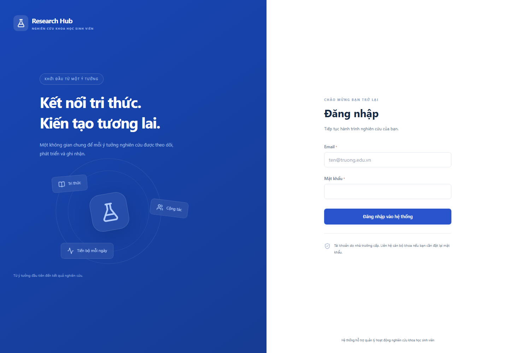
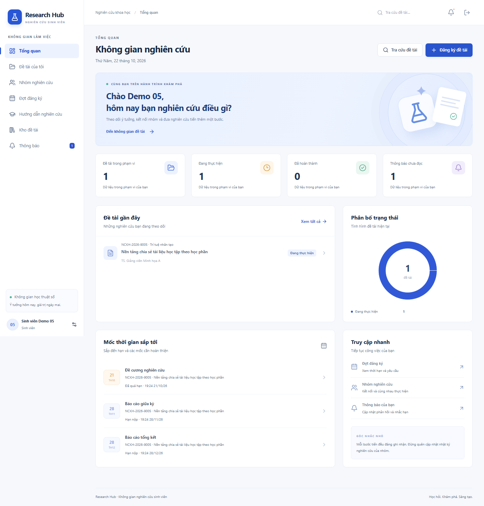
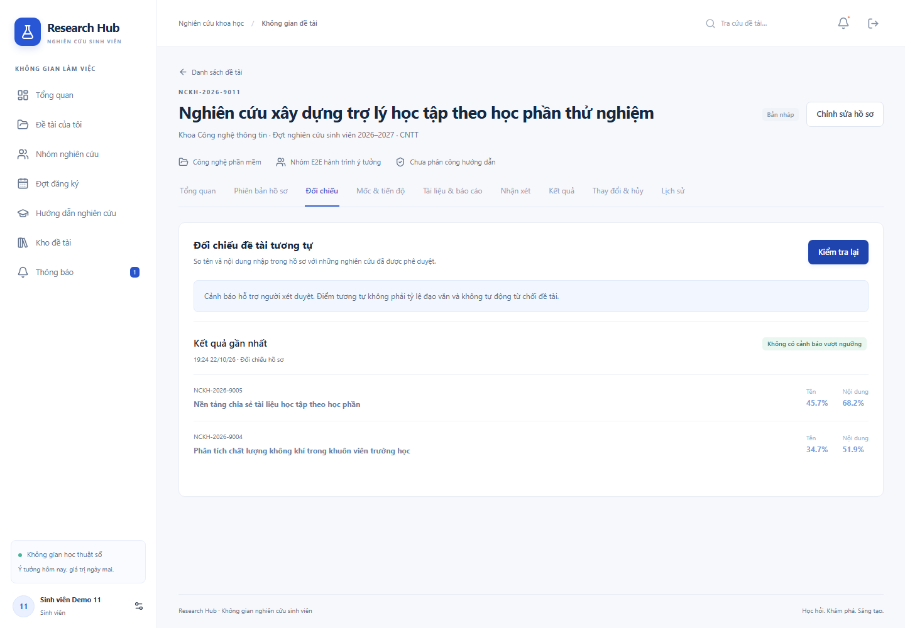
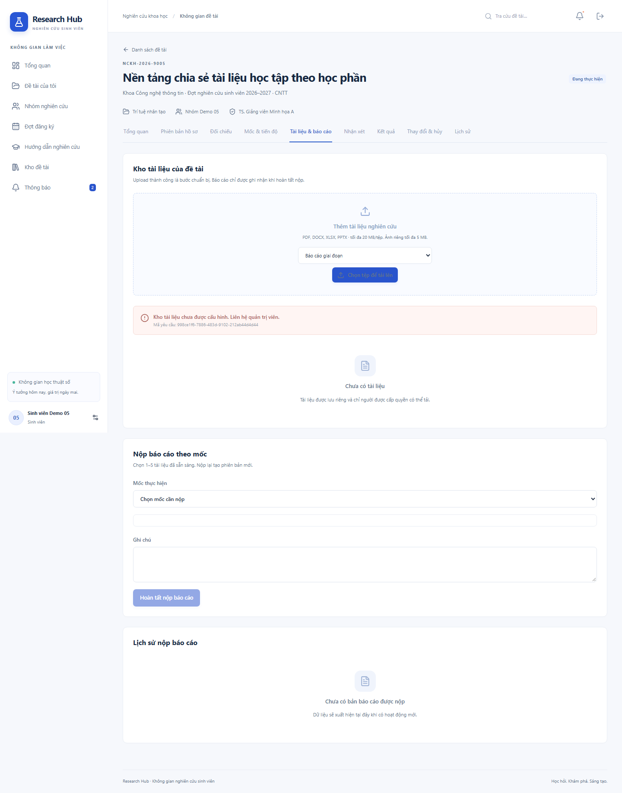
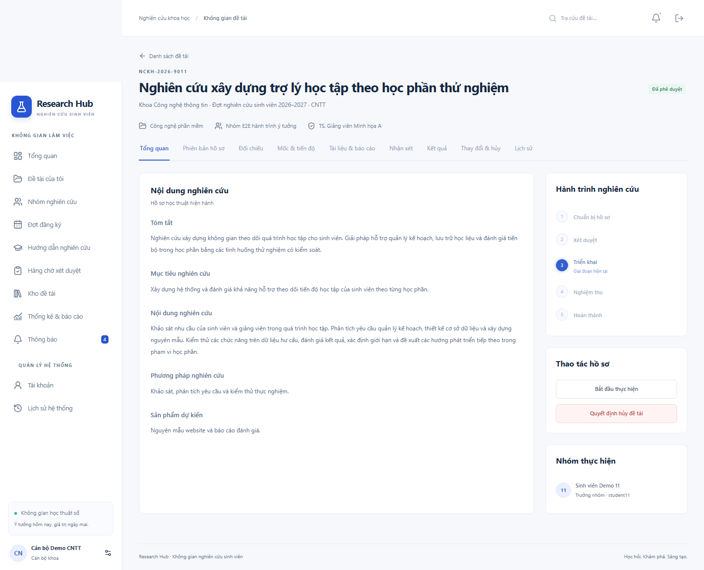
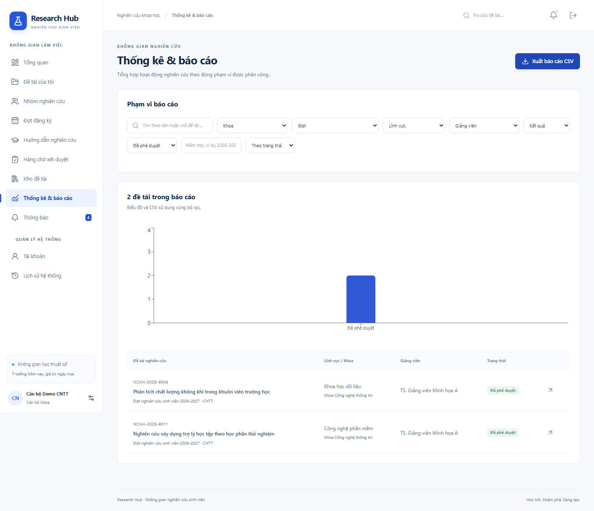
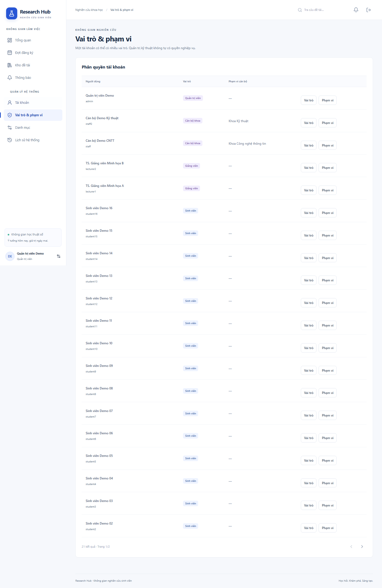
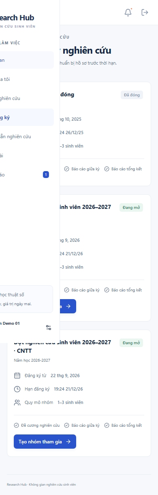

# Hướng dẫn sử dụng

Dữ liệu minh họa đều hư cấu. Ảnh trong tài liệu được chụp từ ứng dụng chạy thật trên database E2E riêng. Nội dung thực tế thay đổi theo dữ liệu và quyền tài khoản.

## Đăng nhập và hồ sơ

Đăng nhập bằng email được cấp; mật khẩu demo local xem `DEMO_PASSWORD` trong `.env`. Nếu tài khoản được cán bộ tạo/reset, đổi mật khẩu ở Hồ sơ trước khi dùng hệ thống. Quên mật khẩu: liên hệ cán bộ/quản trị; bản đầu không gửi email/SMS. Bấm tên của bạn ở cuối sidebar để mở hồ sơ. Ảnh đại diện là ảnh công khai; tài liệu nghiên cứu được kiểm soát riêng theo quyền.

## Sinh viên và trưởng nhóm

1. Xem **Đợt đăng ký**: thời hạn, quy mô nhóm và các mốc.
2. Vào **Nhóm nghiên cứu**, tạo nhóm hoặc nhận lời mời. Mỗi sinh viên chỉ có một nhóm hoạt động trong cùng đợt. Lời mời chưa đồng ý chưa giữ chỗ. Trưởng nhóm tìm thành viên bằng mã chính xác, có thể đổi tên, chuyển quyền hoặc đóng nhóm chưa có hồ sơ.
3. Tạo hồ sơ đề tài, lưu nháp. Điền tóm tắt, mục tiêu, nội dung, phương pháp và sản phẩm dự kiến trước khi gửi. Chỉ trưởng nhóm sửa/gửi. Đổi nội dung học thuật làm mất xác nhận hướng dẫn cũ.
4. **Tổng quan** của đề tài → đề nghị hướng dẫn. Chờ đúng giảng viên đồng ý.
5. **Đối chiếu** → kiểm tra. Điểm tên/nội dung riêng, tối đa 5 kết quả. Cảnh báo cần rà soát; không phải tỷ lệ đạo văn và không tự từ chối hồ sơ.
6. Gửi xét duyệt. Hồ sơ được giữ thành phiên bản; học thuật và roster khóa khi đang chờ. Nếu có tài liệu đề xuất, chọn **Tài liệu & báo cáo → Gửi hồ sơ và tài liệu xét duyệt** để đưa file vào snapshot.
7. Sau duyệt và bắt đầu thực hiện, cập nhật nhật ký ở **Mốc & tiến độ**. % là tự khai, không thay xác nhận mốc.
8. **Tài liệu & báo cáo**: upload trước, chọn mốc và file ready, bấm **Hoàn tất nộp báo cáo**. Tối đa 5 tệp, ít nhất một PDF/Office. Ảnh riêng là minh chứng bổ trợ. Thời điểm finalize quyết định nhãn muộn. Nộp lại upload file mới, giữ bản cũ.
9. Xem **Nhận xét**. Mốc đã đạt chỉ nộp lại khi giảng viên mở lại có lý do.
10. Khi mọi mốc bắt buộc có bản hiện hành đạt và không còn yêu cầu thay đổi/hủy pending, trưởng nhóm đề nghị nghiệm thu.

Thiếu Cloudinary sẽ hiện lỗi cấu hình, không ghi nhận upload/nộp thành công. Đây là trạng thái hiện tại của bàn giao local:

## Giảng viên

Vào **Hướng dẫn nghiên cứu** để xem nội dung được cấp và nhận/từ chối đề nghị. Đề tài đã phân công xuất hiện trong **Đề tài của tôi**. Bắt đầu thực hiện sau khi cán bộ duyệt. Tại **Nhận xét**, chọn bản hiện hành, ghi nhận xét và quyết định nhận xét/cần sửa/đạt. Bản đã đạt không đổi quyết định trực tiếp; mở lại mốc có lý do tại **Mốc & tiến độ** và nhận bản mới.

Khi đề tài chờ nghiệm thu, dùng **Kết quả** để chọn đạt/không đạt và nhận xét. Điểm 0–10 tùy chọn, không tự quyết định kết quả. Nếu cần sửa, trả về thực hiện và chọn mốc cần mở lại. Giảng viên cũ mất quyền workspace/nghiệp vụ khi thay thế có hiệu lực.

## Cán bộ khoa

**Hàng chờ xét duyệt** → mở hồ sơ → xem phiên bản đã gửi trước khi quyết định. Phê duyệt tạo các mốc theo cấu hình đợt và chốt giảng viên đã nhận hướng dẫn. Nếu có cảnh báo tương tự, ghi lý do chấp thuận ít nhất 10 ký tự. Yêu cầu sửa/từ chối luôn cần lý do.

Sau duyệt, **Thay đổi & hủy** xử lý đề nghị nội dung/thành viên/giảng viên/hủy. Với thành viên mới, trưởng nhóm gửi lời mời trong yêu cầu; người mới đồng ý trước, cán bộ áp dụng sau. Giảng viên mới cũng phải đồng ý. Chỗ tham gia được kiểm tra lại lúc áp dụng. Nếu hồ sơ đã thay đổi, yêu cầu có thể bị conflicted và cần gửi lại.

**Kết quả → Sửa sai** tạo phiên bản mới, không ghi đè. **Lịch sử → Khoảng quyền** cho phép xem và thu hồi quyền đọc lịch sử có lý do. Không tự quyết hồ sơ mà tài khoản của mình tham gia.

**Thống kê & báo cáo** lọc khoa, đợt, lĩnh vực, giảng viên, năm học, trạng thái và kết quả. CSV dùng đúng bộ lọc của màn hình, mỗi đề tài một dòng.

## Quản trị viên

Quản lý tài khoản, import CSV, trạng thái, reset mật khẩu, vai trò, phạm vi và danh mục. Quản trị kỹ thuật không tự có quyền xét duyệt, chấm điểm hoặc tải file riêng. Muốn làm nghiệp vụ phải được cấp vai trò và scope phù hợp như các tài khoản khác. Không gỡ/khóa admin hoạt động cuối cùng.

CSV tối đa 500 dòng. Header: `accountCode,email,fullName,password,facultyCode,classCode,roles`. Dùng mã danh mục ở màn hình Danh mục; nhiều vai trò cách nhau `|`. Có lỗi bất kỳ dòng nào thì toàn bộ danh sách chưa được ghi. Mật khẩu mới sau reset chỉ hiển thị trong lần cấp; chuyển riêng cho người dùng.

## Trên điện thoại và các tình huống thường gặp

Mở nút menu ở góc trái để điều hướng. Bảng rộng cuộn ngang trong khung bảng. Lỗi mạng có thể thử lại; lỗi xung đột revision cần tải lại dữ liệu. Đừng tạo yêu cầu khác khi chưa biết thao tác trước có thành công: nút gửi bị khóa khi đang xử lý và retry cùng dữ liệu giữ khóa chống gửi lặp.

Rời nhóm trước duyệt mất quyền riêng. Rời sau duyệt chỉ đọc các bản trong khoảng được cấp; tham gia lại không mở quyền cho khoảng vắng. Hồ sơ hoàn thành/từ chối/hủy giải phóng chỗ tham gia và giữ lịch sử theo quyền.

